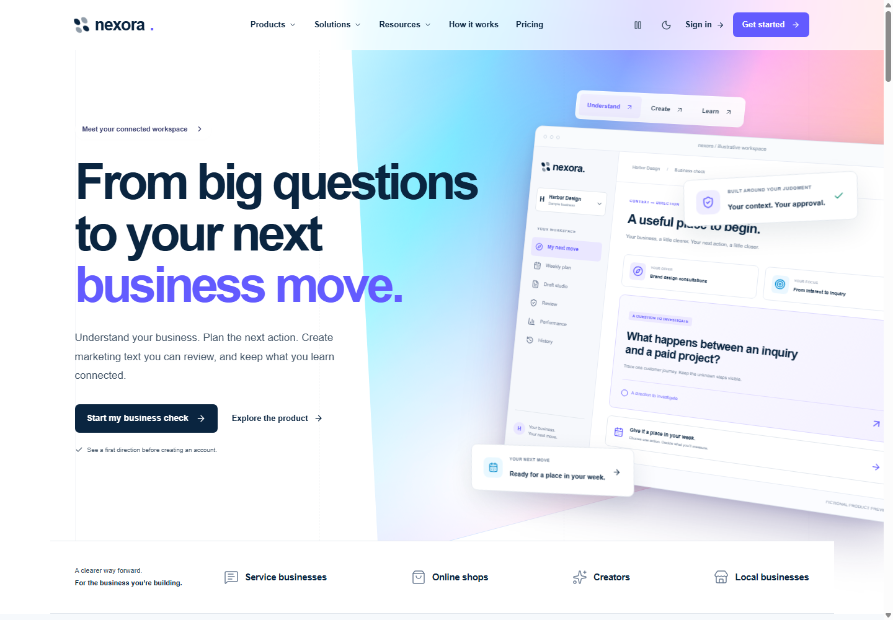

# NEXORA 제품 사이트·탐색 구조 개편

2026-11-10, Asia/Seoul. 사용자가 요청한 [Stripe 홈페이지](https://stripe.com/)의 제품 탐색·시각 구성을 참고해 **실제 프로젝트 화면을 다시 구현**했다. Stripe의 이름·로고·고객·실적·자산을 가져오지 않았으며, NEXORA에서 제공하는 업무에 맞춰 구성했다.

## 실제 달라진 화면

- **메인:** 큰 네이비 타이포그래피, 움직이는 보라·청록·핑크 배경, 기울어진 제품 화면과 겹친 상태 카드, 직접 바꾸어 보는 Understand / Create / Learn 미리보기.
- **상단 메뉴:** Products / Solutions / Resources 메가 메뉴와 How it works / Pricing. 짧은 링크 나열을 기능·사업 유형·자료별 탐색으로 확장했다. 제품 메뉴에는 6개 실제 업무를 설명하는 하위 링크를 두었다.
- **제품 탐색:** 사업 체크·주간 계획·초안·검토 승인·측정·이력의 6개 화면을 탭으로 전환한다. 초안의 메시지 선택과 승인본/수정본 선택도 반응한다. 공개 미리보기는 허구의 사례이며 계정 데이터와 연결하지 않는다.
- **사업 유형:** 서비스·온라인 매장·크리에이터를 선택하면 설명·질문·작업·가이드·시작 링크가 함께 바뀐다. URL에 선택을 유지하며 실제 첫 체크 또는 가이드로 이어진다.
- **내용 구성:** 제품 시연, 사업별 독자적 그림, 연결 관계 다이어그램, 기존 인터랙티브 샘플, 작업 이어하기 설명, 자료 라이브러리, 가격 요약, 다음 행동을 서로 다른 형태로 배치했다.
- **하단 탐색:** 제품·솔루션·자료·계정·법적 안내를 가진 공통 푸터를 메인과 공개 하위 페이지에 적용했다. 가입·첫 체크·계정 작업에는 같은 푸터를 강제로 끼우지 않았다.
- **브랜드 일관성:** 보라색 주 행동과 네이비 글자색을 공통 토큰으로 반영해 기존 체크·가격·작업 화면도 새 공개 페이지와 이어지도록 했다.

## 추가 페이지와 목적

| 주소 | 사용자가 할 수 있는 일 |
|---|---|
| `/product` | 전체 제품을 시연하고 6개 기능의 역할·범위·실제 작업 경로를 확인 |
| `/product#business-check` | 가입 전 사업 체크와 근거 중심 조사 방향 이해 |
| `/product#weekly-plan` | 추천과 연결된 계획·기한·측정 기준 이해 |
| `/product#draft-studio` | 유료 텍스트 패키지와 참조 문구 기능 이해 |
| `/product#review-approval` | 정확한 버전의 승인과 수정본 재검토 이해 |
| `/product#performance` | 직접 기록한 측정치·출처·기간을 보는 방법 이해 |
| `/product#history` | 이전 맥락과 기록을 보존하고 내보내는 과정 이해 |
| `/solutions?business=services` | 서비스 사업의 문의→프로젝트 흐름을 조사할 출발점 선택 |
| `/solutions?business=ecommerce` | 상품 방문→결제 흐름과 실제 기록을 조사할 출발점 선택 |
| `/solutions?business=creator` | 콘텐츠→실제 유료 제안 흐름을 조사할 출발점 선택 |
| `/resources` | 기존 8개 실무 가이드, 제품 사용 안내, 허구 예시, 가격·계정 도움말 탐색 |

하위 메뉴를 채우기 위해 개발자용 공개 API·외부 연동·팀 기능·고객 사례·고객 로고를 만들지 않았다. 실제 계정의 생성·승인·결과 기록은 기존 인증·저장 절차를 그대로 사용한다. 현재 구독 가격·포함량·출시 조건은 [7일 출시 계획](SEVEN_DAY_LAUNCH_PLAN.md)에 있다.

## 메뉴와 모바일 동작

데스크톱 메뉴는 마우스 호버와 클릭으로 열고, 메뉴를 이동할 때 짧은 지연으로 깜박임을 줄인다. 키보드 아래 화살표로 하위 링크에 진입하고 Escape로 닫은 뒤 원래 버튼에 포커스를 돌려준다. 실제 링크는 페이지·제품 설명 위치·사업 시작 화면으로 연결된다.

모바일은 전체 카테고리를 먼저 보여 주고 각 항목을 펼친다. 배경 스크롤과 뒤에 있는 본문·푸터의 조작을 막으며, 닫기·Escape·경로 이동·데스크톱 크기로 변경 시 이를 복원한다. 동작 줄이기 설정과 시각 효과 일시정지를 지원한다. 화면과 공개 시연의 고정된 가상 기록은 실제 사업 성과가 아니다.

## 실제 화면과 검증

[Products 메가 메뉴](reviews/2026-11-10/platform/screenshots/products-menu-desktop.png) · [제품별 시연](reviews/2026-11-10/platform/screenshots/product-explorer-desktop.png) · [제품 페이지](reviews/2026-11-10/platform/screenshots/product-page-desktop.png) · [솔루션 페이지](reviews/2026-11-10/platform/screenshots/solutions-page-desktop.png) · [자료 라이브러리](reviews/2026-11-10/platform/screenshots/resources-page-desktop.png).

[모바일 메인](reviews/2026-11-10/platform/screenshots/home-mobile.png) · [모바일 메뉴](reviews/2026-11-10/platform/screenshots/navigation-mobile.png) · [모바일 제품 메뉴 펼침](reviews/2026-11-10/platform/screenshots/navigation-mobile-products.png) · [다크 테마](reviews/2026-11-10/platform/screenshots/home-desktop-dark.png).

[메인 전체 길이 화면](reviews/2026-11-10/platform/screenshots/home-full-desktop.png)에서 제품 시연부터 마지막 공통 푸터까지 한 번에 확인할 수 있다.

- TypeScript와 새 공개 페이지를 포함한 Next.js 16.4.6 **최종 프로덕션 빌드 통과**.
- 기존 자동 테스트 **14개 파일·90개 통과**. 저장·승인·과금·측정의 서버 처리 로직은 이 디자인 수정에서 변경하지 않았다.
- 실제 Chrome에서 Products 메뉴의 호버·첫 클릭 유지·두 번째 클릭 닫기·키보드 아래 화살표·Escape 포커스 복귀를 확인했다.
- 6개 제품 시연 전환, 업종 선택과 URL 반영, 실제 가이드 8개 연결, 모바일 메뉴 펼침·닫힘·페이지 이동·화면 크기 변경 시 배경 복구를 확인했다.
- 메인·제품·솔루션·자료·가격·가이드의 **320/390/768/1024/1440px** 가로 넘침과 헤더 잘림을 검사했다. 시연의 의도된 겹침·가장자리 구도와 별개로 가로 스크롤은 발생하지 않았다.
- 다크 테마, 시각 효과 일시정지, 동작 줄이기 설정을 확인했다. 이 검사는 실제 iOS Safari나 스크린리더 인증을 대신하지 않는다.
- 프로덕션 모드에서 기존 가입→명시적 사업 저장→프로필·측정치→진단→주간 계획→실제 수동 행동·결과→재로그인 동선도 통과했다. 브라우저 런타임 예외가 없었다.

종료 전 작성한 파일이 남아 있음을 확인하고 마지막 빌드·브라우저 검증까지 이어서 완료했다. 검사는 `.qa/platform/`의 격리 데이터와 Chrome 프로필을 사용했다. 운영 데이터, 외부 AI 호출, 결제, 메일 발송, 광고, 배포는 수행하지 않았다.

로컬 확인: 프로젝트 터미널에서 `npm.cmd run dev` 실행 후 `http://localhost:3000`에 접속한다. 로컬 검증에 사용한 서버는 작업 종료 시 닫았다.

주요 구현: [탐색 메뉴](src/components/layout/Navbar.tsx), [메인](src/components/marketing/LandingExperience.tsx), [제품 시연·그림·푸터](src/components/marketing/PlatformExperience.tsx), [사업 유형 선택](src/components/marketing/SolutionsExperience.tsx), [공통 스타일](src/app/platform.css), [탐색 정의](src/lib/marketing/catalog.ts).
