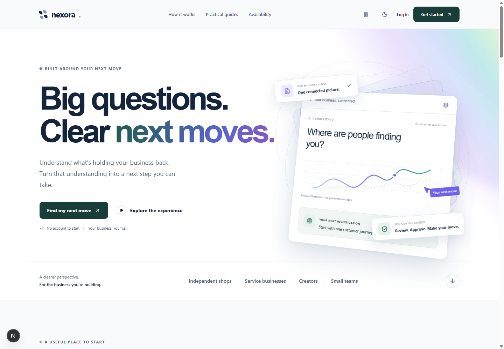

# NEXORA 시각 경험·반복 사용 기능 구현

구현·확인일: 2026-11-10, Asia/Seoul.

사용자가 지정한 Stripe·Scale의 홈페이지와 성장·투자 관련 일차 자료를 확인하고, 현재 NEXORA 앱의 공개 화면과 작업 흐름에 적용했다. 아래 화면은 별도 제안 이미지가 아니라 **현재 코드가 실제 Chrome에서 렌더링한 결과**다. 예시 사업·문구·검사용 계정은 허구이며 고객 실적이 아니다.

## 실제 적용 화면

[모바일 메인](reviews/2026-11-10/implementation/landing-mobile.png) · [다크 배경의 검토 흐름](reviews/2026-11-10/implementation/quality-desktop.png) · [직접 조작하는 메시지 체험](reviews/2026-11-10/implementation/interactive-desktop.png) · [모바일 결과·계속 버튼](reviews/2026-11-10/implementation/first-direction-mobile.png) · [실제 초안 검토 화면](reviews/2026-11-10/implementation/draft-studio.png).

## 두 기업의 장점과 NEXORA에 적용한 것

성장 원인 전체를 디자인 하나로 설명할 수는 없다. 고객 확보와 투자 설명은 공개된 자료의 범위에서 해석했다. 회사·투자사의 주장은 독립적인 성과 검증과 구분한다.

| 기업의 원리 | 확인한 근거 | NEXORA에 적용한 내용 |
|---|---|---|
| Stripe: 복잡한 기능을 이해하고 시작하기 쉽게 만듦 | 현재 홈페이지는 한 가지 결과 중심 메시지, 시작 CTA, 제품 시각화, 단계별 확장을 연결 | 큰 제목·명확한 시작 버튼·겹쳐진 제품 화면·업무별 진입·하나로 연결된 네 단계 흐름 |
| Stripe: 첫 고객에게 적극적으로 도입을 도움 | YC의 Paul Graham은 초기 Stripe가 고객의 현장에서 직접 설치를 돕던 방식을 기록 | 가입 전 체험, 짧은 선택형 체크, 단계 이어하기, 결과를 본 뒤 명시적으로 저장하는 경로. 실제 고객의 초기 사용을 대표가 돕는 영업은 별도 운영 과제 |
| Stripe: 고객 업무 안에서 지속적으로 확장 | 회사의 연간 업데이트는 결제 외 청구 등 인접 금융 업무 확장을 설명 | 기본 체크→계획→초안→승인→측정으로 맥락 유지. 다음 작업에 승인된 문구를 선택적으로 재사용 |
| Scale: 정확한 데이터와 사람 검토가 중요한 병목을 해결 | 초기 회사 발표는 단순한 학습 데이터 API와 정확도·속도·품질 운영을 강조 | 사용자 입력·조사 방향·승인을 층으로 보여주는 시각화. 사실·가설·실제 사용을 구분하고 정확한 버전 승인 유지 |
| Scale: 중요한 고객 문제와 제공 역량을 증명 | Accel의 후속 투자 설명은 고객 적용, 데이터 운영 규모, 팀의 실행을 근거로 설명 | 승인 이력·정확한 재사용 출처·소유자 분리·관찰 결과 보존. 고객별 원가·유료 반복 사용·영업 재현성은 실제 자료로 추가 검증할 과제 |

출처: [Stripe 홈페이지](https://stripe.com/), [초기 Stripe 고객 도입 사례](https://paulgraham.com/ds.html), [Stripe의 2025년 업데이트](https://stripe.com/newsroom/news/stripe-2025-update), [Scale 홈페이지](https://scale.com/), [Scale 초기 투자 발표](https://scale.com/blog/announcing-our-series-a-with-accel), [Accel의 Scale 투자 설명](https://www.accel.com/news/the-next-step-of-ai-our-continued-investment-in-scale).

VC에게 설득력을 주는 것은 고객의 반복 사용·실제 지불·품질·원가·확장 가능성을 연결하는 증거다. 이번 화면에 외부 기업의 로고를 고객 로고처럼 넣거나, 투자 실적·성장 수치·후기를 만들어 넣지 않았다. 현재 미지원 기능도 실제 가능한 기능처럼 표현하지 않았다.

## 구현한 화면과 상호작용

| 영역 | 변경 |
|---|---|
| 메인 | 큰 타이포그래피, 움직이는 다색 배경, 입체 제품 카드, 고민별 진입, 단계별 업무 그림, 다크 배경의 데이터·판단·승인 시각화 |
| 가입 전 체험 | 온라인 판매·서비스·크리에이터 선택, 메시지 A/B 선택, 소셜·이메일 미리보기. 결과가 즉시 바뀌며 허구 예시임을 표시 |
| 사용 안내·이용 범위 | 같은 시각 체계와 작업 단계 적용. 현재 제공 범위와 외부 연결이 필요한 범위를 구분 |
| 가입·로그인 | 사업 맥락을 보여주는 제품 그래픽. 모바일에서는 큰 그래픽을 줄여 폼에 빨리 도달 |
| 첫 체크·진단 | 단계 진행 표시, 사업·고민·다음 조사를 잇는 시각적 요약. 모바일 결과에서는 저장·계속 버튼을 하단에 고정하고 입력 중에는 숨김 |
| 작업 기본 화면 | 실제 승인 대기 초안, 사용 대기 승인본, 진행 중 계획, 새 결과에 따라 다음 작업을 먼저 표시. 저장 작업 수와 사업 성과를 구별 |
| 초안 제작 | ‘한 가지 오퍼’, ‘짧은 이야기’, ‘두 메시지 비교’ 패키지. 상세 수량은 펼쳐서 조정 |
| 초안 검토 | 실제 입력에 반응하는 텍스트 미리보기. 저장하지 않은 편집과 승인된 정확한 버전을 구별 |
| 주간 계획 | 주간 이동을 한 줄로 압축. 진척 설명은 필요할 때 펼치고 실제 계획에 빨리 도달 |
| 공통 | 대비를 높인 색 토큰, 모바일 메뉴·안전 영역, 모션 정지, 동작 줄이기, 기존 기록·성과·가이드 화면의 공통 스타일 |

전체 320·390·768·1024·1440px에서 메인의 가로 넘침을 검사했다. 다크 테마, 동작 줄이기, 모바일 핵심 작업도 확인했다. 실제 iOS Safari·스크린리더 전수 검증이나 접근성 인증을 뜻하지 않는다.

## 이탈을 줄이기 위해 실제로 보강한 기능

### 1. 승인한 표현을 다음 초안에 참고

제작 화면에서 ‘Use my approved wording as a style reference’를 선택할 수 있다. 같은 계정·같은 사업의 최근 승인본 최대 3개를 사용하며, 사용자는 내용과 버전을 확인하고 끌 수 있다.

승인본이 없는 초안과 다른 계정의 표현은 포함하지 않는다. 현재 버전이 미승인이어도 최신 승인 버전을 따로 찾는다. 참조 내용은 생성 작업에 스냅샷으로 남겨 어떤 버전을 사용했는지 추적한다. 분량을 제한하며, 지난 가격·할인·효능을 현재 사실로 가져오지 않도록 지시한다. 이는 표현 참고 기능이지 자체 모델 학습이나 매출 효과 검증이 아니다.

관련 코드: [승인본 선택](src/lib/business/approved-wording.ts), [생성 요청](src/lib/business/generation.ts), [소유자별 선택·스냅샷](src/lib/server/operations.ts), [제작·미리보기](src/components/workspace/AssetsPanel.tsx).

### 2. 멈춘 단계에서 이어하기

첫 체크의 답뿐 아니라 현재 단계도 해당 탭에 보관한다. 업종까지만 선택하고 새로고침했을 때 결과 화면으로 건너뛰던 동작을 수정했다. 완료한 체크는 완료 결과로 다시 열린다. 계정 저장은 계속 명시적으로 수행한다.

관련 코드: [체크 진행 보관](src/lib/first-check-session.ts), [첫 체크](src/components/check/FirstCheckExperience.tsx).

### 3. 재방문에서 바로 할 일 제시

기록 수만 보여주는 대신 검토할 초안, 아직 사용 기록이 없는 승인본, 남아 있는 주간 계획, 최신 결과 검토를 연결한다. 새로운 생성·저장·성과가 실제로 발생하지 않았는데 완료했다고 표시하지 않는다.

관련 코드: [재방문 기본 화면](src/components/workspace/WorkspaceOverview.tsx).

### 4. 뒤로 가기와 저장 상태의 오해 줄이기

작업 섹션 이동을 브라우저 이력에 남기고, 뒤로 가기에서 섹션과 선택 맥락을 복원한다. 단순히 요청이 진행 중이 아니라는 이유로 모든 입력이 저장됐다고 표시하던 전역 문구는 ‘Signed in’으로 바꿨다. 개별 편집의 저장·승인 상태는 별도로 표시한다.

이 변경만으로 모든 폼의 미저장 내용을 자동 보관하는 것은 아니다. 사이트 전체 폼 자동 복구는 별도 기능이다.

## 확인 결과

- 13개 파일의 77개 자동 테스트 통과.
- TypeScript 검사와 Next.js 프로덕션 빌드 통과.
- 실제 Chrome에서 공개 화면→첫 체크→가입→명시적 저장→진단→주간 계획→가이드 왕복→행동·성과→재로그인 확인.
- 별도 QA 초안으로 승인 대기 연결, 문구 참고 끄기, 패키지 선택, 편집 미리보기, 새 버전 저장·정확한 버전 승인, 브라우저 뒤로 가기 확인.
- 시각화 단계 선택, 업종·메시지·채널 선택, 모션 정지·동작 줄이기, 중단·완료 체크 재개 확인.
- 검사용 SQLite와 Chrome 프로필을 `.qa/visual-redesign/`에 분리. 운영 데이터·외부 AI·결제·광고·게시를 호출하지 않음.

새 자동 검사는 계정 간 승인본 유출 방지, 미승인 편집 제외, 참고 끄기, 분량 제한, 진행 단계 보존을 포함한다. 제공자 응답은 테스트 fixture이며 실제 AI 품질·제공자 계정 연결을 입증하지 않는다.

## 외부 설정·실제 고객이 필요한 부분

| 항목 | 남은 일 |
|---|---|
| 실제 텍스트 생성 | 운영 제공자 키·모델·예산 설정 후 실제 영어·브랜드 품질과 원가 확인 |
| 결제·유료 파일럿 | 판매자 계정·지급 계좌·상품 범위·환불·청구 연결과 실제 결제 검증 |
| 이메일·계정 회복 | 발송 계정·도메인 인증·지원 운영과 재설정 흐름 |
| 완성 이미지·영상·게시 | 제공자·소재 권리·플랫폼 권한·검수·원가·실제 실행 검증 |
| 자동 분석 자료 수집 | 실제 고객 계정 권한·자료 정의·연결·재동기화 |
| 고객·VC 유치 | 직접 시연·유료 제공·두 번째/세 번째 구매·고객별 원가·채널별 확보 비용의 실제 증거 |
| 이탈률 개선 | 퍼널 수집·동질 코호트·충분한 관찰 기간을 갖춘 비교. 이번 구현만으로 감소 수치를 주장할 수 없음 |

초기 고객에게는 새 홈페이지·체험을 보여준 뒤 같은 최근 업무를 함께 끝내고, 실제 사용과 다음 업무 재구매를 확인하는 방식을 권한다. 공개 예시 체험을 실제 고객 성과로 계산하지 않는다. 실제 연락·외부 게시·투자 제안은 이번 코드 변경에 포함하지 않았다.

로컬 실행: `npm.cmd run dev` 후 `http://localhost:3000`. 이번 검증은 별도 포트·저장소에서 수행했고 운영 배포는 하지 않았다.
