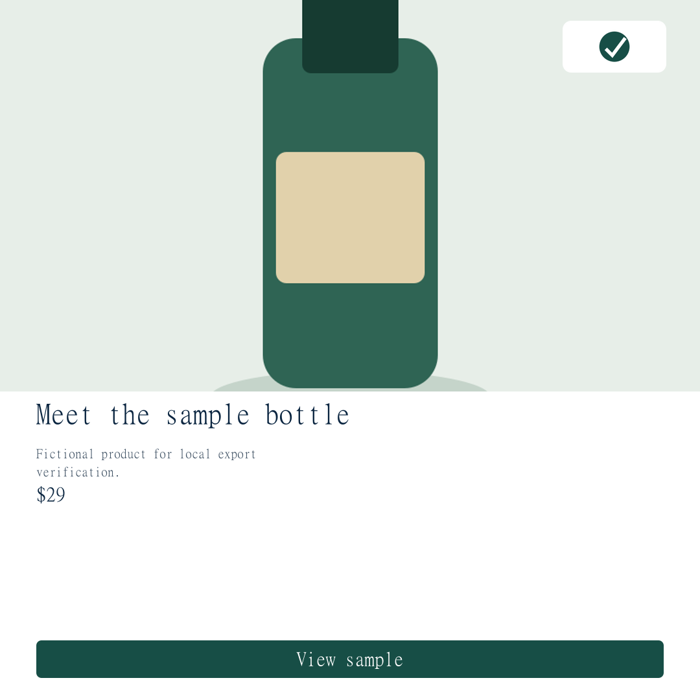
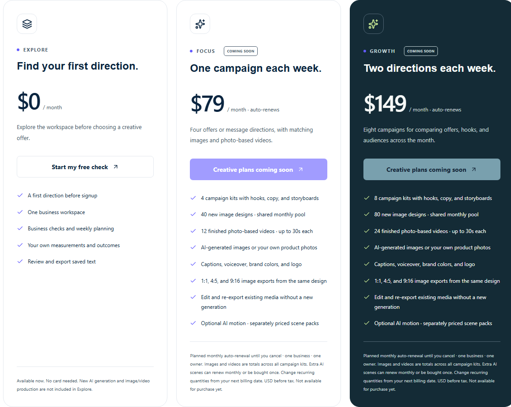

# NEXORA 프로젝트 종합 정리 보고서

기준일: 2026-11-12 · 한국어 · 내부 검토용

## 01. NEXORA 프로젝트 종합 정리 보고서

프로젝트가 추구하는 방향과 고객의 결과, 현재 구현·상품·재무·출시 과제의 전체 기록

자동 테스트 123개 통과 · 화면 25개 / API 38개 라우트 파일 · 신규 유료 판매 PREVIEW

**기준일: 2026년 11월 12일 · Asia/Seoul**

현재 로컬 작업 트리, 프로젝트 문서, Git 이력, 고객 제안서 V2·V3 및 재무 계산 원자료를 대조해 작성했다. 사업 방향과 고객 결과는 직접 산출물·기대효과·미검증 성과로 구분한다.

> **내부 검토용 · 비공개 재무 가정 포함** 이 문서는 현재까지의 프로젝트를 설명하는 종합 기록이다. 실제 고객 매출·수요·세금·투자 유치·운영 배포를 확정한 실적 보고서가 아니다.

## 02. 목차

고객 가치부터 현재 구현, 출시 조건과 내부 재무 모형까지 순서대로 읽을 수 있다.

## 03. 현재 프로젝트의 위치와 정리 범위

> **현재 판단** 무료 사업 체크·계획·측정과 계정 기반 업무 흐름을 갖췄다. 텍스트 AI·결제·메일 연결 코드와 사진 기반 정적 이미지 제작 코드가 존재하지만, 전체 유료 크리에이티브 상품은 아직 판매 준비 상태다.

| 구분 | 이번 기준에서 확인한 내용 |
| --- | --- |
| 프로젝트 | NEXORA. 저장소 폴더명 upstage-main, npm 패키지명 startup-platform과 공개 브랜드가 다르다. |
| 실제 조사 범위 | src 파일 175개, 화면 25개, API route 파일 38개, 문서·작업 기록·상품 카탈로그·재무 원자료. |
| 기준 코드 | HEAD 3cdb748 · 2026-11-11 17:34:38 KST. 11/12의 상당한 구현은 미커밋 작업 트리에 존재한다. |
| 이번 재검사 | ESLint 오류 0·경고 5, TypeScript 통과, 17개 테스트 파일·123개 테스트 통과, 격리 프로덕션 빌드 통과. |
| 출시 상태 | 로컬 preflight 24개 BLOCK. 카탈로그 preview 및 delivery/billing readiness false. 실제 운영 설정 확인과 납품 완성이 남았다. |
| 자료 우선순위 | 현재 코드·현재 검사 → 최신 상품 카탈로그/운영 문서 → 과거 검토 기록. 재무는 외부 V3 최신본을 기준으로 하고 V2를 비교한다. |

### 상태를 읽는 방법

**구현**은 코드가 있다는 뜻이며, **로컬 검증**은 정해진 시험 조건을 통과했다는 뜻이다. **운영 미검증**은 실제 외부 계정·배포에서 아직 확인하지 않았다는 뜻이다. **계획**은 제공하려는 범위이며, **고객 효과 미검증**은 실제 사용자의 시간·비용·매출 개선 자료가 없다는 뜻이다.

비밀키·실계정 세션·고객 DB 내용은 보고서에 담지 않았다. 파일 해시 목록과 새 검사 로그를 동봉해 근거와 조사 시점을 추적할 수 있게 했다.

근거: package.json; git log/status; src/ 전체; verification/*.log; source-manifest.json

## 04. 프로젝트가 추구하는 방향

**NEXORA는 소규모 사업자가 자신의 사업 맥락을 이해하고, 이번에 실행할 일을 정한 뒤, 사람이 승인한 결과물을 사용하고 관측한 결과를 다음 판단으로 이어 가는 작업 공간을 지향한다.**

사업 맥락 → 조사 방향 → 주간 실행 → 제작·검토 → 정확한 버전 승인 → 실제 사용 → 측정·재검토

| 설계 원칙 | 제품에서 의미하는 것 | 고객에게 주려는 가치 |
| --- | --- | --- |
| 맥락을 보존 | 상품·고객·채널·목표와 당시 근거를 저장 | 다음 작업에 같은 설명을 반복하는 부담을 줄일 기반 |
| 사실·가설을 구분 | 자기보고 정보·측정·자료 부족·가능한 원인을 분리 | 왜 이 행동을 권하는지 이해하고 수정 |
| 사람이 통제 | 수정은 새 버전, 승인은 정확한 저장본에 부여 | 사실·가격·표현·권리를 검토한 결과만 사용 |
| 업무를 연결 | 추천·목표·문구·사용·측정 이력을 연결 | 이번 작업을 끝내고 다음 관찰로 이어 갈 기반 |
| 기록을 정직하게 | 완료·다운로드를 게시·매출로 계산하지 않음 | 활동량과 실제 사업 변화를 구분 |

### 장기 비전과 이번 상품의 관계

사업 이해와 실행·학습을 연결하는 것이 장기 비전이다. 최근 상품은 그 비전을 반복 캠페인 제작이라는 구체적인 업무로 좁힌다. 브리프·문구·이미지·영상이 일관된 상품 사실과 브랜드 표현을 쓰고, 검토·승인·내보내기까지 이어지는 캠페인 패키지가 목표다.

> **현재 연결 수준** 사업 판단·텍스트·계획·결과 기록은 연결돼 있다. 이미지 스튜디오는 사진·문구 등을 직접 입력하는 별도 제작 흐름이다. 텍스트가 이미지·완성 영상으로 자동 변환되는 전체 파이프라인은 아직 완성되지 않았다.

근거: README.md; src/components/marketing/LandingExperience.tsx; src/lib/marketing/catalog.ts; CREATIVE_OFFER_IMPLEMENTATION.md

## 05. 대상 고객과 초기 상품의 초점

공개 제품은 독립·소규모 사업자를 폭넓게 설명한다. 서비스업·온라인 매장·크리에이터 경로를 제공하며, 음식점·카페·숙박·오프라인 소매·전자상거래·서비스·크리에이터용 질문과 공통 질문이 있다. 업종별 질문이 있다는 사실은 해당 업종에서 고객 효과가 검증됐다는 뜻이 아니다.

| 층위 | 현재 의미 | 결정 수준 |
| --- | --- | --- |
| 장기 고객 범위 | 자신의 사업을 직접 운영하고 판단·실행·측정을 이어 가려는 작은 사업 | 공개 제품 방향 |
| 전략 검토의 초기 가설 | 반복 캠페인이 있는 미국 소형 온라인 브랜드·작은 판매팀의 한 과제 | 11/10 제안. 확정 ICP·수요 증거 아님 |
| 다른 출시 문서의 예시 | 이미 판매·고객 문의가 있는 미국 소규모 서비스 사업자 | 당시 모집 예시. 위 가설과 구분 필요 |
| 현재 상품 구조 | 작은 첫 제작 → 월간 캠페인 루틴 → 선택형 AI 장면 | 최신 공개 예정 카탈로그 |

### 고객이 구매하려는 구체적인 일

“무슨 말을 해야 할지”에서 시작해, 한 상품의 메시지와 소재를 확인하고, 사용 가능한 버전을 승인하고, 실제 사용 뒤 다음 행동을 판단하는 일이다. 문구 개수보다 반복 업무를 끝낼 수 있는가가 핵심 가치 가설이다.

### 초기 제품 범위에 포함되지 않는 일

- 광고 플랫폼 자동 게시, 광고비 집행, 주문·판매 자동 수집, 고객지원 대행은 없다.
- 팀 초대·공동 승인·다중 사업 워크스페이스와 공개 개발자 API는 현재 제공 범위로 확인되지 않는다.
- 대표 개인의 수령 목표는 내부 경제성 조건이다. 고객이 구매하는 결과와 구분한다.

> **포지셔닝의 남은 선택** 첫 유료 고객군과 반복 과제를 하나의 설명으로 확정할 필요가 있다. 이 보고서는 과거의 서로 다른 타깃 제안을 하나의 검증된 고객군으로 합치지 않는다.

근거: reviews/2026-11-10/STRATEGY_REVIEW.md; SEVEN_DAY_LAUNCH_PLAN.md; src/lib/marketing/catalog.ts; CREATIVE_OFFER_IMPLEMENTATION.md

## 06. 고객이 얻을 수 있는 결과

| 고객의 필요 | 직접 얻는 결과 | 현재 제공 조건 |
| --- | --- | --- |
| 무엇부터 볼지 모름 | 고민·업종·단계에 맞춘 첫 조사 질문과 다음 행동 | 가입 전 무료 체크에서 확인 |
| 해야 할 일이 흩어짐 | 기한·상태·평가 지표가 있는 주간 과제 | 계정에 저장한 진단과 연결 |
| 표현 초안이 필요 | 훅·광고 문구·숏폼 글 대본·CTA | 유효한 유료 권리와 실제 텍스트 공급자 필요 |
| 안심하고 사용하고 싶음 | 수정 이력과 정확한 버전의 승인본·텍스트 다운로드 | 저장·승인 조건을 충족한 결과물 |
| 상품 사진으로 광고 준비 | 사진·로고·문구·브랜드색을 조합한 PNG/JPG | 코드·로컬 검증 있음. 유효한 크리에이티브 권리·워커 필요. 신규 판매 닫힘 |
| 다음에도 맥락 유지 | 당시 프로필·근거·승인본 참조와 작업 이력 | 선택적 참고이며 자동 모델 학습 아님 |
| 실행 후 다시 판단 | 사용 기록·기간·출처·통화가 있는 측정과 재진단 근거 | 직접 기록. 자동 데이터 수집 없음 |

### 준비 중인 상품이 제공하려는 최종 결과

한 상품의 메시지·이미지·편집이 서로 맞는 캠페인 패키지다. 사진 기반 최대 30초 완성 MP4, AI 이미지 생성, 음성 합성, 선택형 8초 AI 장면은 아직 구현을 완료하지 않았다. 정적 이미지 저장·출력의 일부가 구현됐다는 이유로 전체 미디어 상품을 지금 구매 가능하다고 설명할 수 없다.

> **고객 결과의 세 단계** ① 파일·계획·승인 기록은 기능으로 확인한다. ② 반복 설명·수정 부담·작업 시간이 줄었는지는 실제 과제로 비교한다. ③ 매출·전환율·ROAS 개선은 별도 측정이 필요하다. 현재 ②·③의 개선 수치는 입증되지 않았다.

근거: README.md; CREATIVE_OFFER_IMPLEMENTATION.md; MEDIA_OPERATIONS.md; src/components/workspace/ImageStudio.tsx; src/lib/server/image-studio.ts

## 07. 고객 여정과 일주일 활용 예시

가입 전 첫 방향 → 명시적 계정 저장 → 이번 주 과제 → 문구·정적 이미지 → 승인·외부 사용 → 측정·다음 판단

다음은 한 상품의 주말 홍보를 준비하는 소형 온라인 브랜드를 가정한 설명이다. 실제 고객 사례·완료 실적이 아니다. 생성과 이미지 출력은 공급자·유료 권리·워커가 유효한 조건을 전제로 한다.

| 시점 | 고객 행동 | 남는 결과와 확인점 |
| --- | --- | --- |
| 월요일 | 고민·상품·고객·판매 채널과 최근 방문/주문 기록 정리 | 첫 조사 방향, 프로필·근거·진단. 모르는 수치는 빈값으로 남김 |
| 화요일 | 한 오퍼를 주간 과제로 정하고 문구 방향 선택 | 기한·평가 지표가 있는 계획. 권한과 공급자 설정 시 텍스트 초안 |
| 수요일 | 가격·주장·CTA를 수정하고 문구 버전 승인 | 승인 텍스트와 수정 이력. 별도 스튜디오에 사진·로고·문구를 직접 입력 |
| 목요일 | 저장한 이미지 버전을 승인하고 규격 선택 | 조건 충족 시 1:1·4:5·9:16 PNG/JPG. 워커 상태와 완료 파일 확인 |
| 금요일 | 파일을 내려받아 외부 채널에 직접 사용 | 사용 기록을 별도로 남김. 다운로드를 게시·판매로 계산하지 않음 |
| 관측 기간 후 | 같은 정의의 방문·주문·광고비와 출처 입력 | 비교 가능한 측정과 새 진단. 짧은 변화만으로 효과를 단정하지 않음 |

### 이 과제를 끝냈다고 말할 수 있는 기준

일정이 있는 한 작업, 확인·승인한 문구와 정적 이미지 파일, 실제 사용 기록, 다음 검토에 쓸 측정 근거가 남아 있어야 한다. 승인·파일 다운로드까지만 했으면 외부 사용이나 고객 반응까지 완료한 것으로 표시하지 않는다.

> **가입과 저장은 별개** 첫 체크는 해당 탭의 sessionStorage에 남는다. 가입만으로 사업 답변이 계정으로 올라가지 않는다. 사용자가 저장을 선택했을 때 계정의 프로필·근거·진단으로 연결한다.

근거: README.md; src/lib/first-check-session.ts; src/components/workspace/WorkspaceApp.tsx; MEDIA_OPERATIONS.md

## 08. 지금까지의 변화와 결정 이력

| 시점 | 주요 변화 | 그 시점의 의미 |
| --- | --- | --- |
| 5~9월 | 초기 구현과 프로젝트 문맥·지침·테스트 기반 축적 | 커밋 메시지만으로 세부 기능 완료일을 확정하기 어려움 |
| 11/2 전후 | 브라우저 저장·규칙 점수 중심 구조에서 계정·서버·근거·승인·성과 구조로 전환, 안내 기능 복원 | 과거 KRW·로컬 기록은 보존·명시적 가져오기 |
| 11/5 | 미국 영어 UI, 고민 중심 첫 체크, 명시적 저장, 다음 행동 중심 화면 | 당시 결제·메일 부재 기록은 후속 구현 이전 상태 |
| 11/10 | 시각 랜딩·조작형 예시·재방문 작업·승인본 스타일 참고·체크 재개 | 당시 77개/13파일 기록. 고객 유지율 효과는 미검증 |
| 11/10 | 월 $149/$299 텍스트 구독, Stripe·Resend·한도/메일 복구 코드 | 90개/14파일 기록. 실제 운영 결제·메일 확인 전 |
| 11/10 | 제품·솔루션·리소스 페이지와 메가 메뉴, 시각 체계 개편 | 공개 탐색과 실제 계정·업무 경로 연결 |
| 11/11 | $79/$149 미디어 상품 공개 예정 안내, 신규 결제 차단 | 당시 낮은 원가 기반 대표 수령 계산은 후속 감사에서 철회 |
| 11/12 상품 | $19 첫 제작, 캠페인 구독과 선택형 AI 장면 분리, 자동 갱신·수량 변경·해지 | V2 제안 이후 V3 자동 갱신 명시. 카탈로그는 계속 preview |
| 11/12 최신 | 사진 기반 정적 이미지·비공개 파일·워커·온라인 백업·격리 복원·상태 점검 | 이번 최신 검사 123개/17파일. 전체 영상·AI 미디어 납품 미완성 |

문서별 테스트 수와 미구현 표는 해당 시점의 기록이다. “현재까지”의 상태에는 커밋 후 작업 트리 변경도 포함된다. 최근 HEAD는 `3cdb748`이며 앞선 `2fff75f`, `927f980`, `8f2bf6c`, `ddf53fb` 순의 업데이트 기록이 있다.

> **설계상의 중요한 전환** 임의의 건강 점수나 성공확률보다 확인한 정보·모르는 점·실행·측정의 연결을 우선한다. 공개 상품 역시 문구 개수에서 캠페인 산출물과 반복 업무 중심으로 이동했다.

근거: PROJECT_STATUS.md; RESTORATION_REPORT.md; EXPERIENCE_REDESIGN.md; VISUAL_EXPERIENCE_IMPLEMENTATION.md; STRIPE_STYLE_REDESIGN.md; git log

## 09. 전체 기능과 현재 상태

| 영역 | 현재 구현 범위 | 남아 있는 조건/제약 |
| --- | --- | --- |
| 첫 체크 | 가입 전 고민·업종·단계와 조사 방향, 중단 재개 | 답변은 명시적으로 저장하기 전 탭에 보관 |
| 계정·프로필 | 회원가입·세션·소유자별 저장·프로필 버전 | 인증·복구 메일은 실운영 설정/전달 확인 전 |
| 근거·진단 | 수기 측정, 조건별 조사 질문과 권장 행동 | 원인 확정·시장 데이터 자동 검증·성공 예측 아님 |
| 텍스트 AI | Responses 호출·구조 검증·패키지 예약/한도 | 실모델 설정·유료 권한·영어 품질 실측 필요 |
| 승인·내보내기 | 새 버전 수정·정확한 버전 승인·복사/텍스트 다운로드 | 승인과 실제 외부 사용을 별도 기록 |
| 주간 실행 | 추천 연결 목표·기한·상태·메모·관련 버전 | 과제 완료가 매출이나 사용 기록을 만들지 않음 |
| 성과·재검토 | 기간·단위·통화·출처 보존, 비교 가능한 그래프 | 외부 분석/주문 자동 가져오기·인과 기여 없음 |
| 사진 이미지 | 실제 업로드·버전·승인·PNG/JPG 3비율·한도 원장 | 유효한 creative 권리·로컬 워커. 신규 판매 닫힘 |
| AI 이미지·영상 | 공개 상품/견적에 계획 범위 설명 | AI 생성·MP4·음성·장면 공급자/원장 미완성 |
| 결제 | 기존 텍스트와 별도 creative 구독·수량/해지/추가결제 코드 | Stripe 실설정·실청구 확인 전. 준비 상태로 신규 차단 |
| 운영 | DB·미디어 백업/검증/격리복원, health/readiness | 영구 저장·정기/외부 백업·실제 알림/복구 준비 필요 |

이 표의 “구현”은 모든 신규 고객이 현재 구매해서 사용할 수 있다는 뜻이 아니다. 무료 탐색, 과거 계약 권리, 검증용 유료 fixture, 아직 닫힌 신규 상품을 구분해야 한다.

근거: 현재 src/ 코드; README.md; CREATIVE_OFFER_IMPLEMENTATION.md; MEDIA_OPERATIONS.md

## 10. 첫 체크와 사업 프로필

### 가입 전에 첫 방향을 제공하는 입구

`/start`는 고민 → 사업 유형 → 단계 → 첫 방향을 중심으로 시작한다. 상세 사업 설명과 실제 측정값은 필요할 때 보완한다. 처음부터 긴 진단 양식이나 계정 등록을 요구하지 않으려는 구조다. 진행 중 답과 완료 상태를 해당 탭에 보관해 중단한 위치를 재개한다.

| 수집하는 맥락 | 처리와 의미 |
| --- | --- |
| 사업 유형·단계·업종 | 조사 질문과 해석 방향을 바꿈. 업계 평균이나 합격선으로 점수화하지 않음 |
| 운영·제공 상품·고객·시장 | 소유/팀 맥락, 오퍼와 고객 설명. 모르는 항목은 선택적으로 비울 수 있음 |
| 목표·채널·톤 | 다음 행동과 생성 맥락. 맞춤 문구에는 상품·고객·판매 채널 정보 필요 |
| 통화·시간대 | 새 프로필 기본 제안은 미국·USD·en-US와 브라우저 IANA 시간대 |
| URL·참고 내용 | 고객이 입력한 맥락. URL을 실제로 방문·분석했다는 주장은 하지 않음 |
| 저장 동의·버전 | 명시적 저장 후 계정 프로필·근거·진단으로 연결. 과거 스냅샷을 보존 |

### 기존 계정과 기존 데이터

상세 프로필은 다섯 단계의 안내와 예시를 제공한다. 추가 안내 필드는 기존 레코드에 선택적이다. 프로필 수정이 과거 진단 당시의 프로필을 다시 쓰지 않으며, 새 진단은 새 맥락을 보존한다.

> **기존 브라우저 기록의 호환** 과거 startup-platform-store 기록은 자동 업로드·삭제·USD 변환하지 않는다. 사용자가 백업하고 읽기 전용 레거시 아카이브로 가져오는 경로가 있으며, 과거 KRW와 원문·점수를 새 근거 진단과 섞지 않는다.

근거: README.md; src/lib/business/first-check.ts; src/lib/business/industry.ts; src/lib/first-check-session.ts; src/lib/server/first-check.ts; src/lib/server/operations.ts

## 11. 근거와 진단이 동작하는 방식

고객이 입력한 수치와 맥락을 근거로 조사할 질문과 다음 행동을 정한다. 자기보고 정보와 실제 측정을 구분하고, 근거가 부족하면 부족한 정보와 가능한 대안을 함께 제시한다. 현재 사업 체크를 AI가 실제 시장을 조사한 전문가 진단으로 설명해서는 안 된다.

| 대상 | 현재 규칙/보존 방식 | 해석 |
| --- | --- | --- |
| 측정 레코드 | 시작·종료일 포함 기간, 수치·단위·통화·수기 출처 | 같은 정의로 측정했는지 사용자가 확인 |
| 누락값과 0 | 알 수 없는 값은 누락 상태, 0은 실제 관측값으로 보존 | 빈칸을 성공/실패 숫자로 자동 채우지 않음 |
| 진단 스냅샷 | 프로필·근거·추천 순서를 해당 시점에 저장 | 과거 판단의 이유를 나중에 재현 |
| 조사 방향 | 업종·단계와 지표 조건에 맞는 질문·가능한 원인·대안 | 원인 확정이나 전문 자문 결과 아님 |
| 권장 행동 | 마케팅 제작뿐 아니라 자료 수집·비용 검토 등 | 광고가 먼저라고 일괄 유도하지 않음 |
| 결과 재사용 | 새 실행·측정을 연결 근거로 새 진단 | 새 판단이 과거 기록을 덮어쓰지 않음 |

### 고객이 직접 판단할 수 있게 하는 UI

첫 결과는 유용한 질문과 다음 행동을 먼저 보여 주며, 세부 사실·가능한 원인·다른 선택·빠진 정보·업종 질문은 펼쳐서 확인한다. 개요·첫 방향·전체 보고서에서 저장한 추천 순서를 유지한다.

> **제거하거나 제한한 오해** 검증되지 않은 종합 건강 점수·사업 성공확률·업계 평균 기준을 현재 판단의 근거로 쓰지 않는다. 입력값으로 만들어진 조사 방향과 실제 외부에서 검증한 사실을 구분한다.

근거: README.md; RESTORATION_REPORT.md; src/lib/business/assessment.ts; src/lib/business/validation.ts; src/lib/server/operations.ts

## 12. 텍스트 생성과 공급자 연결

유효한 추천·맥락 → 계정 한도 예약 → 실제 공급자 요청 → 구조 검증 → 작업·초안 저장

현재 유료 AI 공급자 통합은 텍스트다. 서버의 `OPENAI_API_KEY`와 `OPENAI_MODEL`을 사용해 Responses API로 요청하며, 설정이 없으면 명시적으로 실패한다. 허구 응답을 성공 결과처럼 저장하는 대체 동작은 없다.

| 항목 | 구현한 동작 |
| --- | --- |
| 결과물 | 설정 가능한 훅·광고 문구·짧은 영상용 글 대본·CTA 패키지. 영상 대본은 MP4가 아님 |
| 맥락 | 저장한 진단의 상품·고객·판매 채널과 선택한 추천을 사용 |
| 참고 문구 | 직접 넣은 참고와 선택한 승인본을 신뢰할 수 없는 입력 자료로 취급. 없는 분석은 주장하지 않음 |
| 요청 설정 | store:false, 기본 60초 제한·출력 6,000토큰. 실제 모델명은 운영자가 설정 |
| 비용 통제 | 계정별 시간당 시도·서비스 일별 시도·유료 패키지 예약/성공량을 구분 |
| 오류 | 시간 초과·불확실한 결과를 자동 재시도하지 않음. 거절·미완료·손상된 구조는 저장 실패 |
| 추적 | 작업 상태·입출력 토큰과 추정 여부를 보존. 과거 재생성 결과를 유지 |

### 한도와 품질은 다른 문제

성공 재생성은 새로운 패키지를 사용하고, 직접 텍스트 수정은 새 생성량을 쓰지 않는다. 실패는 성공 포함량으로 차감하지 않지만 과도한 시도는 안전 한도로 막는다. 유효한 creative 구독의 텍스트 한도는 Focus 월 4패키지·Growth 8패키지, 각 최대 12자산으로 연결돼 있다. 이런 한도 검사가 영어 표현·상품 사실·채널 적합성을 자동 보장하지는 않는다.

> **남은 실측** 실제 선택 모델에서 사실 오류·수정량·지연·실패율·토큰/시도 비용을 확인해야 한다. 이번 자동 테스트는 모형 응답이며 실제 공급자 호출이나 생성 품질 인증이 아니다.

근거: src/lib/server/provider.ts; src/lib/server/operations.ts; src/lib/server/billing.ts; src/lib/business/approved-wording.ts; .env.example

## 13. 수정·정확한 승인·내보내기

결과물을 “생성했다”는 상태와 “검토해 사용하기로 승인했다”는 상태를 분리한다. 사람이 내용을 바꾸면 새 버전으로 저장하며, 승인은 그 저장 버전에 연결한다. 승인 후 편집 중인 문구와 승인된 문구를 혼동하지 않는 것이 핵심이다.

| 행동 | 기록되는 결과 | 혼동하면 안 되는 것 |
| --- | --- | --- |
| 초안 생성 | 생성 작업과 자산·초기 버전 | 생성이 사실 검증·사용 승인이라는 뜻은 아님 |
| 수정 저장 | 새 버전, 기존 버전·승인 이력 보존 | 기존 승인으로 수정본 전체를 승인하지 않음 |
| 정확한 버전 승인 | 대상 버전과 검토 상태 | 모든 미래 버전이나 다른 자산에 승인 전파 안 함 |
| 복사·텍스트 다운로드 | 승인한 저장 버전의 텍스트 | 외부 게시·광고 집행·실제 사용·매출로 세지 않음 |
| 사용 기록 | 고객이 실제 사용했다고 명시한 실행 기록 | 다운로드 버튼 클릭에서 자동으로 만들지 않음 |
| 새 요청의 참고 | 같은 계정·사업의 최근 승인본 최대 3개 선택 참고 | 자체 모델 학습·성과 학습·현재 상품 사실 보증 아님 |

### 승인본 참고의 범위

참고는 문장 길이·표현 방식·톤을 다음 초안에 반영할 수 있는 선택 기능이다. 과거 가격·효능·재고를 현재 사실로 승격하지 않도록 제한하며, 참고한 정확한 버전의 스냅샷을 작업에 남긴다. 모델을 계정별로 훈련한 기능으로 표현하지 않는다.

### 텍스트와 이미지 승인의 관계

정적 이미지도 저장한 디자인 스냅샷의 버전을 승인한 뒤 내보낸다. 다만 문구 자산 승인과 이미지 디자인 승인은 서로 다른 흐름이다. 한 번의 텍스트 승인으로 이미지·완성 영상 전체가 자동 승인되는 파이프라인은 없다.

근거: src/app/api/assets/[id]/route.ts; src/app/api/assets/[id]/approve/route.ts; src/app/api/assets/[id]/download/route.ts; VISUAL_EXPERIENCE_IMPLEMENTATION.md; MEDIA_OPERATIONS.md

## 14. 주간 실행·결과·성과를 연결하는 법

| 도구 | 저장하는 내용 | 독립적으로 유지하는 상태 |
| --- | --- | --- |
| 주간 계획 /goals | 추천 행동·기한·상태·주간 기준·노트·평가 지표 | 활동 완료는 사업 성과와 다름 |
| 자산 연결 | 같은 진단·행동에 속한 정확한 자산 버전 | 다른 계정/진단의 버전을 임의로 연결하지 않음 |
| 결과 입력 | 사업 행동·승인본 실제 사용·측정 중 필요한 입력 선택 | 완료·사용·수치 기록을 한 번에 자동 생성하지 않음 |
| 시간 | 실제 저장 시간 또는 사용자가 선택한 과거 시점 | Just now를 고정된 가짜 시점으로 만들지 않음 |
| 성과 /metrics | 기간·단위·통화·출처·광고비·가격 변경·노트 | 빈 데이터에서는 실제 그래프를 만들어 내지 않음 |
| 재진단 | 새 결과를 새 근거로 연결 | 과거 프로필·진단 스냅샷은 불변 |

### 비교 가능한 숫자만 비교

- 다른 통화와 기간 길이를 하나의 매출선으로 합치지 않는다. 금액 기록마다 통화를 유지한다.
- 전환율에는 같은 기간과 양수 방문자 분모가 필요하다. 없는 분모나 누락값을 0/가상값으로 채우지 않는다.
- 선으로 연결할 관측치는 정의·대상 집단의 비교 가능성을 확인한다. 선이 있다고 인과 효과가 입증되는 것은 아니다.
- 기한은 진단의 시간대 맥락을 유지한다. 고객의 활동 시간과 USD/KRW를 임의로 바꾸지 않는다.

> **고객이 얻는 학습 결과** 무엇을 실행했고, 어떤 승인본을 썼으며, 어느 기간에 어떤 값이 관측됐는지 남는다. “그래서 다음에 무엇을 확인할까”를 다시 판단할 수 있는 근거가 제품의 직접 결과다.

근거: README.md; src/lib/server/plans.ts; src/lib/business/planning.ts; src/lib/business/performance.ts; src/lib/server/operations.ts; RESTORATION_REPORT.md

## 15. 사진 기반 정적 이미지 제작

최신 작업은 `/workspace#media`의 Images & files다. 고객이 상품 사진·로고를 업로드하고 헤드라인·설명·가격·CTA·브랜드색을 직접 넣어 디자인을 저장한다. AI가 새 이미지를 생성하는 기능이 아니라 업로드한 사진을 광고 레이아웃에 배치하는 기능이다.

| 단계/정책 | 현재 구현 |
| --- | --- |
| 업로드 | 실제 PNG/JPEG/WebP 바이트만 허용. 최대 8MB·16메가픽셀·한 변 6,000px. PNG 재인코딩과 입력 메타데이터 제거 |
| 비공개 저장 | public 밖의 임의 불변 이름·체크섬. 인증·소유자 일치 확인. 사용자 파일명/URL을 경로로 쓰지 않음 |
| 저장·승인 | 디자인 버전을 저장하고 해당 스냅샷 승인. 수정본은 새 승인 필요, 이전 승인은 보존 |
| 내보내기 | PNG/JPG: 1:1 1080×1080, 4:5 1080×1350, 9:16 1080×1920 |
| 사용량 | 확인된 creative 결제 기간의 이미지 1개 예약/소비. 리사이즈와 이미 렌더한 디자인의 직접 수정에 새 디자인 차감 없음 |
| 권리/운영 | 무료·기존 텍스트 계약에 미디어 권리 자동 부여 없음. 워커가 있어야 큐를 처리. 신규 creative 판매는 계속 닫힘 |

이 이미지 원장은 캠페인·완성 영상·AI 장면 사용량까지 구현했다는 뜻이 아니다. 현재 사진 기반 정적 이미지의 저장·승인·출력 범위로 한정한다.

근거: MEDIA_OPERATIONS.md; src/components/workspace/ImageStudio.tsx; src/lib/server/image-studio.ts; src/lib/server/media-files.ts; .qa/launch-actions-2026-11-12/browser-results.json

## 16. 워커·백업·복구·상태 점검

| 영역 | 추가된 코드 | 운영자가 준비할 부분 |
| --- | --- | --- |
| 이미지 워커 | 별도 프로세스 media:worker, loopback 앱 호출, 외부 호스트·리다이렉트 거부, heartbeat | 앱과 워커의 동일 환경·서버 비밀·서비스 재시작/감시 |
| 작업 복구 | 영속 작업 ID·중복 방지, 저장 결과 재확인, 중단된 로컬 작업 조정 | 실제 장애·디스크 오류·재시작 확인. 유료 생성 재시도 아님 |
| 실패/한도 | 확인된 로컬 실패에서 같은 디자인의 다른 대기 작업이 없을 때 예약 해제 | 유료 공급자 과금/장면/영상 실패의 정책은 별도 |
| 온라인 백업 | 읽기 전용 원본과 SQLite online backup, 스냅샷이 참조하는 불변 미디어·체크섬 함께 복사 | 정기 실행·보관 기간·별도 위치/외부 사본·접근 권한 |
| 검증·격리복원 | 변조 탐지, 새 디렉터리만 허용, 기존 앱 DB를 덮어쓰지 않음 | 같은 앱 버전으로 계정·기록·승인·파일 확인 후 실제 전환 판단 |
| health | 공개 /api/health는 프로세스 생존 상태만 노출 | 외부 감시와 알림 수신처·장애 책임자 |
| readiness | Bearer 보호. DB·미디어 읽기/쓰기와 최근 워커 확인, 미준비 시 503 | 실 AI/Stripe/메일·세금·고객 가치까지 인증하지 않음 |

### 재현 가능한 운영 명령

`npm.cmd run media:worker` · `npm.cmd run media:worker -- --once` · `npm.cmd run ops:backup -- --database <절대경로> --media <비공개경로> --destination <새백업경로>` · `npm.cmd run ops:verify-backup -- --backup <백업경로> --restore-to <새격리경로>`

> **현재까지의 완료 범위** 로컬 복구 코드와 시험을 갖췄으며 실제 운영 복구·배포·원격 백업 계정 연결은 수행하지 않았다. WAL을 무시한 실시간 main DB 파일만의 복사는 새 백업 방식이 아니다.

근거: MEDIA_OPERATIONS.md; scripts/image-worker.mjs; scripts/backup-local.mjs; scripts/verify-backup.mjs; src/app/api/internal/readiness/route.ts

## 17. 준비 중인 영상·AI와 품질 방향

| 계획한 결과 | 고객에게 의미하는 것 | 현재 상태 |
| --- | --- | --- |
| AI 이미지 | 사진이 부족할 때 새 시각 소재 생성 | 생성 공급자/실패·사용량·품질검증 미완성 |
| 사진 기반 영상 | 사진 장면·움직임·전환·자막·음성으로 최대 30초 MP4 | 렌더링·음성·완성 MP4 납품 미구현 |
| AI 움직임 장면 | 새로 생성한 8초 장면을 선택적으로 추가 | 가격/구독 권리 코드 일부 있음. 실제 장면 생성·소비 파이프라인 미완성 |
| 같은 캠페인 표현 | 상품 사실·로고·브랜드색·메시지가 서로 일관 | 가치 제안. 텍스트부터 편집까지 완전 자동 전달은 아직 없음 |

### 품질 우선 요구를 실제 기준으로 바꾸기

- 상품의 형태·라벨·가격·효능·주장 등 사실을 보존해야 한다.
- 영어 문장·자막·음성·레이아웃이 대상 채널에서 읽히고 실제 파일로 재생돼야 한다.
- 정확한 저장 버전 검토·소재 권리 확인·수정·승인·납품을 하나의 책임 범위로 정해야 한다.
- 회사 부담 후보 생성·재시도·편집·고해상도·저장·지원 비용을 최종 채택량과 분리해 기록해야 한다.

기존 감사는 낮은 이미지·초당 단가만으로 고급 API 품질과 대표 수령을 함께 보장할 수 없다고 정정했다. 모델명이 비싸다는 사실만으로 최종 광고 품질을 보장할 수 없으며 실제 결과물 평가가 필요하다.

> **출시 설명과 납품의 일치** 공개 가격에는 이미지와 사진 기반 완성 영상이 함께 적혀 있다. 일부 정적 이미지 기능이 완성됐어도 이 전체 약속을 납품할 수 있기 전에는 현 카탈로그의 준비 상태를 해제할 근거가 되지 않는다.

근거: CREATIVE_OFFER_IMPLEMENTATION.md; AD_CREATIVE_PRICING_PLAN.md; API_QUALITY_TAX_CASHFLOW_AUDIT.md; MEDIA_OPERATIONS.md

## 18. 현재 상품·견적과 기존 계약

| 상품 | 세전 가격 | 예정 제공량/조건 |
| --- | --- | --- |
| Explore | 무료 | 사업 체크·계획·저장 기록·기존 텍스트 검토. 신규 AI 제작 권리 없음 |
| First campaign | $19 / 1회 | 캠페인 1·이미지 4·사진 기반 영상 2, 30일 유효. 월 구독 자동 전환 없음 |
| Focus creative | $79 / 월 | 캠페인 4·이미지 40·사진 기반 영상 12. 해지 전 자동 갱신 |
| Growth creative | $149 / 월 | 캠페인 8·이미지 80·사진 기반 영상 24. 해지 전 자동 갱신 |
| 선택 AI 장면 | 1개 $15 / 5개 $59 | 장면당 8초. 월 반복 또는 일회 추가를 선택. 기본 플랜 포함량 0 |

이미지·영상은 캠페인별 각각의 수량이 아니라 월 전체 키트가 공유하는 총량이다. 같은 디자인의 여러 비율을 별도 디자인 여러 개로 세지 않는다. 영상은 최대 30초의 편집 결과이며 그 전 길이를 새 AI 움직임으로 생성한다는 뜻이 아니다.

### 가격 견적 위젯의 실제 동작

0~50개 정수 장면 요청을 받아 요청량 이상을 덮는 최저가 조합을 계산한다. 예를 들어 4개 개별 구매는 $60, 5개 묶음은 $59이므로 5개 묶음을 제시하고 초과 장면도 알린다. 최초 결제 예상액과 매월 갱신액을 구분하며 견적은 청구·한도 예약·공급자 호출을 하지 않는다.

> **과거 텍스트 계약과 분리** 기존 Focus $149/월·16패키지/6자산, Growth $299/월·48패키지/12자산의 계약 권리를 새 공개 가격으로 바꾸지 않는다. creative 권리는 별도 카탈로그·결제 기간을 사용한다.

공개 카탈로그 버전은 `creative-v3-2026-11-12`, 상태는 `preview`다. First campaign의 독립 Checkout은 아직 구현되지 않았으며 모든 신규 creative 구매는 닫혀 있다.

근거: src/lib/marketing/creative-plans.json; src/lib/marketing/creative-plans.ts; src/lib/billing/plans.ts; CREATIVE_OFFER_IMPLEMENTATION.md

## 19. 자동 갱신·수량 변경·해지·환불

| 상황 | 구현한 결제 동작 |
| --- | --- |
| 새 월 구독 | 별도 creative Stripe Price의 USD·금액·exclusive tax·월 주기를 서버에서 대조. 월 기본+선택 월 장면이 자동 갱신 |
| 일회 추가 | 구독 후 계정에서 mode:payment로 구매. 월 갱신 항목을 바꾸지 않으며 검증된 결제 후 30일 권리 부여 |
| 다음 달 수량 | 현재 지불한 기간 보존, proration 없음. 다음 확정 결제일부터 적용하며 새 요청은 이전 예약 선택을 대체 |
| 구독 schedule | end_behavior:release로 예약 단계 뒤에도 선택한 구독이 계속 갱신. 스케줄 종료가 자동 해지가 아님 |
| 추가량 0 | AI 장면 월 추가만 0으로 바꿈. 기본 구독은 계속 갱신 |
| 직접 해지 | 관리 중인 예약 스케줄 해제 후 기간 말 자동 갱신 해지. 이미 지불한 기간의 접근 유지 |
| 중복·경합 | 호출자 request ID·저장 명령·Stripe idempotency·계정 잠금으로 재처리와 충돌 제어 |
| 확인·환불 | 결제 복귀 화면만으로 권리 부여 안 함. Stripe 현재 결제 상태 확인, 재생 이벤트 중복 방지, 일회 추가권 전액 환불 시 해당 grant 회수 |

### 웹훅과 기존 계약 보존

구독·청구 이벤트 외에 `checkout.session.completed`, `checkout.session.async_payment_succeeded`, `charge.refunded` 등을 처리한다. 미결제·이미 환불된 결제에는 새 권리를 주지 않으며 환불이 먼저 도착해도 잘못 부여하지 않도록 검사한다. 기존 텍스트 계약의 포털·기존 권리는 보존한다.

> **코드 완료와 상용 확인의 차이** 실제 Stripe 가격·세금·웹훅·실청구·메일·갱신·해지·환불 동작은 운영 계정에서 확인해야 한다. 자동 갱신 구현이 매출이나 결제 성공을 보장하지 않는다. 현재 게이트는 신규 판매를 차단한다.

근거: src/lib/server/creative-billing.ts; src/lib/server/billing.ts; src/lib/server/billing-shared.ts; src/components/workspace/CreativeSubscriptionControls.tsx; CREATIVE_OFFER_IMPLEMENTATION.md

## 20. 사이트·디자인·탐색 경험

공개 사이트는 네이비 제목·보라색 행동 버튼과 보라/청록/핑크 스펙트럼, 기울어진 제품 화면·상태 카드·직접 조작하는 허구 메시지 예시를 사용한다. 복잡한 연결 업무를 첫 화면에서 이해하고 시작할 수 있게 하는 것이 개편의 목적이다.

| 공개 영역 | 역할 |
| --- | --- |
| 홈·/demo·/start | 제품 방향·허구 텍스트 시연·실제 무료 첫 체크의 구분 |
| /product | 사업 체크·계획·초안·승인·성과·연결 이력의 여섯 축 |
| /solutions | 서비스·온라인 매장·크리에이터의 상황별 업무와 경로 |
| /resources·/explore·/guide | 8개 공개 가이드와 사용 안내·기존 업무로 돌아가는 경로 |
| /pricing·/terms·/privacy | 최신 예정 상품·자동 갱신·범위·판매자/정책 안내 |

메가 메뉴는 Products/Solutions/Resources를 묶고 호버·클릭·키보드·Escape·포커스 복귀를 고려했다. 모바일 펼침·배경 스크롤, 다크 모드·모션 줄이기 검사 기록이 있다. 기록된 Chrome 검사 범위가 실제 iOS/전체 보조공학 접근성 인증을 뜻하지는 않는다.

근거: STRIPE_STYLE_REDESIGN.md; VISUAL_EXPERIENCE_IMPLEMENTATION.md; src/components/layout/; src/components/marketing/; .qa/recurring-billing-v3/browser-results.json

## 21. 기술 구조와 데이터 흐름

| 계층 | 주요 기술/파일 | 책임 |
| --- | --- | --- |
| 화면 | Next.js 16.4.6 · React 19.2.4 · TypeScript | App Router 화면과 워크스페이스, 서버 API 호출 |
| 스타일·시각 | Tailwind CSS 4, Framer Motion, Lucide, Recharts, next-themes | 반응형·모션·아이콘·관측값 차트·테마 |
| 사업 로직 | src/lib/business/ | 유효성·진단·업종 질문·계획·성과·승인본 참고 |
| 서버 | src/lib/server/ + route.ts | 인증·소유권·저장·생성·결제·메일·파일·워커 상태 |
| 영속 저장 | Node >=24.14 내장 node:sqlite, WAL | 사용자·세션·사업 기록·청구/사용량·미디어 작업 |
| 이미지 | sharp 0.35.5, private media 디렉터리 | 실바이트 검증·메타데이터 제거·정적 렌더·체크섬 |
| 외부 연동 | OpenAI Responses, Stripe SDK 23.1.0, Resend | 텍스트 생성·결제/권리·인증/복구 메일 코드 |
| 품질 도구 | ESLint 9.39.4 · TypeScript 5.9.3 · Vitest 5.1.0 · GitHub Actions | 정적 검사·단위/서버 회귀·빌드 CI 정의 |

브라우저 → 동일 출처 API → 인증·검증 → 사업/결제 로직 → SQLite·private files

텍스트 요청은 별도의 공급자로 나가고, 결제 웹훅은 Stripe 상태를 대조해 계정 권리를 갱신한다. 이미지 워커는 동일 로컬 앱의 보호 API를 호출해 큐와 파일을 처리한다. 현재 구조는 단일 앱 인스턴스와 영구 디스크를 전제로 한다.

> **구조적 제약** 영구 디스크 없는 호스팅이나 각 인스턴스가 서로 다른 로컬 SQLite를 쓰는 확장에 그대로 적용할 수 없다. 향후 확장에는 DB·객체 저장·작업 큐·권리 트랜잭션 설계를 함께 바꿔야 한다.

근거: package.json; package-lock.json; next.config.ts; src/lib/server/; .github/workflows/ci.yml; MEDIA_OPERATIONS.md

## 22. 계정·데이터·보안 경계

| 경계 | 현재 구현과 한계 |
| --- | --- |
| 비밀번호 | scrypt 해시·개별 salt, 12~128자 입력. 알 수 없는 이메일에도 같은 비싼 해시 계산 |
| 세션 | 무작위 토큰 원문 대신 SHA-256 해시 저장, 7일 쿠키. HttpOnly·SameSite=Strict·운영 Secure |
| 소유권 | 사업 기록·자산 버전·다운로드·미디어·결제 리소스를 계정 소유자로 제한 |
| 변경 요청 | Origin 일치·cross-site 차단·JSON 검사. 미디어 업로드는 별도 제한·검증 |
| 크기·빈도 | JSON 본문 최대 512KB, 인증·생성·업로드 빈도와 처리 용량 제한 |
| 외부 결과 | 공급자 완료·구조·바이트 한도 검사. 원문 오류·SQL·경로·키를 일반 오류에 노출하지 않음 |
| 파일 | 실제 still 이미지 디코딩·재인코딩, public 제외, 불변 임의명·체크섬, 인증된 소유자 다운로드 |
| 웹 헤더 | CSP·HSTS·nosniff·DENY 프레임·Referrer/Permissions/COOP/CORP 설정 |
| 운영 경계 | 워커 Bearer token, 공개 health는 단순 생존, readiness는 비공개 |

### 데이터가 보존되는 단위

사용자·세션, 계정별 프로필과 진단 스냅샷, 근거·초안 버전·승인·계획·실행·결과, 생성 작업·결제 고객/이벤트/잠금/권리, 업로드 객체·미디어 디자인·작업·사용량을 구분해 저장한다. 파일과 백업에는 비공개 사업 데이터와 비밀번호 해시가 포함될 수 있다.

> **실운영에서 확인할 부분** 백업 접근 권한·호스팅 권한·TLS·리버스 프록시 Origin·키 관리·정책/삭제·장애 대응은 코드 검사만으로 확인할 수 없다. 이번 보고서 작성 중 실제 비밀이나 고객 레코드를 열람하지 않았다.

근거: src/lib/server/auth.ts; src/lib/server/http.ts; src/lib/server/database.ts; src/lib/server/media-http.ts; src/lib/server/media-files.ts; next.config.ts

## 23. 메일·약관·개인정보 안내

| 영역 | 구현한 내용 | 운영 확인/제약 |
| --- | --- | --- |
| 메일 인증 | Resend로 1회용 링크 전달, 검증 토큰 해시 저장·24시간 유효 | 실제 발신 도메인·전달 성공/실패 확인 필요 |
| 비밀번호 복구 | 30분 1회용 링크, 새 scrypt 해시 저장, 기존 세션 폐기 | 토큰 만료·목적·재사용 검증. 공급자 미설정이면 명시적 오류 |
| 메일 요청 보호 | 전역·이메일별 요청 제한, 미등록/이미 확인 계정의 불필요한 발송 생략 | 대량 남용/지원·배달 장애 관리는 실제 운영 필요 |
| 판매자·정책 | 운영 주체·주소·지원 연락처와 승인값이 없으면 prelaunch draft 표시 | 현재 확정된 법적 판매/정책 승인으로 해석하지 않음 |
| 환불 초안 | 첫 구독 결제 후 7일 내 지원 요청, 이후 갱신은 예외 사유 중심 검토 | 해지는 자동 환불이 아님. 지원이 Stripe에서 처리·접근 영향 확인 |
| 고객 데이터 | 계정·사업/근거·초안/승인·계획/결과와 비공개 사진·파일 보관 안내 | 접근·정정·삭제는 지원 요청. 직접 계정 삭제 API는 현재 목록에 없음 |
| 공급자 전송 | 선택한 맥락/참고를 텍스트 AI에 전송, Stripe는 결제, Resend는 계정 메일 | store:false가 공급자 전체 처리·보관 정책 부재를 뜻하지 않음 |
| 브라우저 저장 | 필수 세션·탭의 미저장 체크·환경 설정. 별도 광고/분석 태그 없음 | 사진 레이아웃 도구는 이미지를 AI 공급자에 전송하지 않음 |

약관은 한 사업·한 소유자 범위, USD 세전 가격·만료·한도·구독 갱신·고객 직접 해지·저장 작업 접근을 설명한다. 팀 좌석·다중 사업·광고 집행·분석 가져오기·전담 인적 제작은 제외한다. 창작물의 권리·상품 주장·출시 적합성은 사람이 확인한다.

> **확정 전에 남은 일** 새 미디어 상품의 최종 환불 자격·저장/삭제 기간·처리 국가·실제 판매 주체·세금 처리와 지원 책임을 맞춰야 한다. 이 장은 현재 앱의 초안을 정리한 것이며 확정된 계약이나 새 법률 판단이 아니다.

근거: src/lib/server/account-email.ts; src/components/marketing/LegalNotice.tsx; src/app/api/account/; reviews/2026-11-10/launch/OPERATIONS_RUNBOOK.md

## 24. 실행 환경과 운영 연결

| 설정 묶음 | 변수/준비 내용 |
| --- | --- |
| 실행 | Node.js >=24.14, 단일 앱, npm ci, npm run dev/build/start |
| 공개 주소 | APP_ORIGIN, NEXT_PUBLIC_SITE_URL: 실제 공개 HTTPS 기준 주소와 일치 |
| 영속 저장 | NEXORA_DB_PATH 절대경로, NEXORA_MEDIA_PATH는 public 밖 비공개 영구경로 |
| 텍스트 | OPENAI_API_KEY, OPENAI_MODEL. timeout/token/시도 한도는 선택 수치 설정 |
| Stripe 공통 | STRIPE_SECRET_KEY, STRIPE_WEBHOOK_SECRET, STRIPE_PORTAL_CONFIGURATION과 실제 세금/판매자 설정 |
| 상품별 Price | 기존 STRIPE_PRICE_FOCUS/GROWTH와 별도 CREATIVE_FOCUS/GROWTH, 장면 월/일회 4종 |
| 메일·지원 | RESEND_API_KEY, NEXORA_EMAIL_FROM, NEXT_PUBLIC_SUPPORT_EMAIL과 실제 도메인 인증 |
| 판매자·승인 | NEXORA_LEGAL_NAME, NEXORA_LEGAL_ADDRESS, NEXORA_LEGAL_APPROVED, NEXORA_LIVE_TESTS_APPROVED, NEXORA_PAID_LAUNCH_ENABLED |
| 워커 | NEXORA_WORKER_TOKEN은 운영자 생성 서버 비밀 32자 이상, NEXORA_WORKER_ORIGIN은 loopback |

기존 `.env.example`에는 텍스트·결제·메일 항목이 있다. 미디어 경로·워커 항목은 최신 MEDIA_OPERATIONS.md에서 안내한다. 실제 비밀을 생성하거나 이 보고서에 기록하지 않는다.

### 로컬 설정 점검 결과

`npm.cmd run launch:preflight`는 네트워크 호출 없이 값의 설정 여부와 기본 조건을 확인한다. 이번 로컬 결과는 Node 조건만 통과하고 24개가 차단됐다. 로컬에서 미설정이라는 뜻이며 원격 운영 서버의 설정을 읽은 결과가 아니다.

> **출시 스위치는 마지막 단계** status:available과 mediaDelivery/versionedBilling 준비 조건, 운영 계정·법적 판매자·실제 연결 확인을 만족해야 한다. 플래그만 true로 바꾸어 미완성 상품을 판매할 수 없도록 닫혀 있다.

근거: .env.example; MEDIA_OPERATIONS.md; scripts/launch-preflight.mjs; src/lib/server/creative-billing.ts; verification/preflight.log

## 25. 이번 검증과 기존 검증 기록

| 검사 | 2026-11-12 이번 실행 | 증명 범위 |
| --- | --- | --- |
| ESLint | 종료 0 · 오류 0 · 경고 5 | 3개 과거 검토 스크립트 미사용 변수 + 앱 미사용 import 2개 |
| TypeScript | 종료 0 · tsc --noEmit 통과 | 현재 소스의 정적 타입 정합성 |
| Vitest | 종료 0 · 17개 파일/123개 통과 | 생성·권한·청구·미디어·백업 등의 모형/격리 테스트 |
| 프로덕션 빌드 | 종료 0 · Next 16.4.6 통과 | NEXORA_ISOLATED_DEV=1, .next-qa로 격리 빌드 |
| 재무 원자료 | V3 기존 단위시험 8개 통과, 별도 교차 확인 통과 | 카탈로그·V2/V3 주요 값·36개월 CSV/JSON·회사/개인 흐름 일치. 실제 사업 가정 인증 아님 |
| preflight | 종료 1 · 24개 BLOCK | 준비/설정 미충족을 의도대로 차단 |
| 브라우저 | 이번 앱 전체 동선 재실행 안 함 | 기존 11/12 저장 JSON과 허구 QA 화면을 검토 |
| 보안 DB audit | 이번 새 네트워크 조회 안 함 | 기존 11/12 검토의 high/critical 0·moderate 7은 과거 시점 결과 |

### 가장 최신 기존 브라우저 증거

가격/자동 갱신 기록은 18개 검사 통과다. 이미지/파일 기록은 14개 검사 통과, 예외 없음·실결제 0·유료 공급자 0이다. 1:1·4:5·9:16 파일, 한 디자인 차감, 다른 계정 다운로드 거부, 무료 계정 출력 제한과 320/390/1280px 등을 검사했다. 이번 보고서에서는 이를 재실행 결과로 바꾸지 않는다.

테스트 로그에는 node:sqlite 실험 기능 안내와 Fontconfig 캐시 쓰기 경고가 있었으나 테스트는 전부 통과했다. 빌드의 SQLite 경고 역시 실패가 아니었다.

> **실제로 검증하지 않은 일** 실제 모델 생성 품질·실청구/갱신·메일 전달·운영 배포·운영 복구·실사용 고객 반응·매출 효과는 이번 검사로 입증되지 않는다.

근거: verification/lint.log; typecheck.log; tests.log; build.log; preflight.log; finance-model-tests.log; financial-crosscheck.json; 기존 QA browser-results.json 2종

## 26. 문서 간 차이와 최신 정정

| 기존 표현/기록 | 현재의 정확한 해석 |
| --- | --- |
| “미디어 파일/납품 경로가 없다” | 과거 점검 시점. 현재 사진 업로드·비공개 파일·정적 PNG/JPG 출력·워커 존재. AI 이미지/영상은 계속 미완성 |
| “결제·메일이 없다” | 11/5 이전 상태. 현재 연결 코드 존재, 실제 계정 설정·성공/실패 확인 전 |
| README 90개·검토 91개·상품 110개 테스트 | 각 시점 기록. 이번 최신 재실행은 17파일·123개 |
| 출시 설정 20개 BLOCK | 과거 항목 수. 새 creative Price 등으로 현재 로컬 preflight는 24개 BLOCK |
| Focus $149 / Growth $299 | 기존 텍스트 계약. 신규 공개 creative 예정가는 $79/$149. 계약 권리 자동 재가격 없음 |
| 구상품 AI 장면 60/120초 포함 등 | 과거 제공량. 최신 기본 장면 0, 8초 장면 $15/5개 $59 선택 추가 |
| 고객 제안서 V2 | 가격·기본 제작량은 최신과 같지만 후속 V3에서 월 자동 갱신·월 추가·다음 결제일 수량/해지를 명시 |
| 750명·개인 약 2,410만원 | 낮은 원가와 세금/현금 가정의 과거 결론. 감사에서 철회, 현행 대표 수령 근거로 사용 금지 |
| 재무 대안 $199/$399 또는 $149/$299 | 별도 경제성 비교안이며 현재 공개 가격으로 확정 반영되지 않음 |
| 자동 브랜드 학습·통합 생성 기대 | 현재 선택 승인 문구 스타일 참고와 수동 이미지 구성. 완전 자동 제작/성과 학습 없음 |

과거 문서는 당시 결정과 한계를 이해하는 기록으로 보존했다. 보고서 작성으로 기존 문서·코드·원자료를 수정하거나 이동하지 않았다. 재무 원본과 프로젝트 밖의 보관 사본을 모두 유지하는 기존 결정도 이번 작업에서 바꾸지 않았다.

근거: README.md; PROJECT_REVIEW_2026-11-12.md; API_QUALITY_TAX_CASHFLOW_AUDIT.md; CREATIVE_OFFER_IMPLEMENTATION.md; MEDIA_OPERATIONS.md; 외부 customer-offer-v2/v3

## 27. 유료 출시 전에 충족할 조건

| 우선 | 남아 있는 일 | 완료를 확인할 기준 |
| --- | --- | --- |
| P0 납품 | 공개 약속한 이미지·사진 기반 MP4와 선택 AI 생성/장면 구현 | 계정별 생성→수정→정확한 승인→실파일 저장/다운로드가 실제로 성공 |
| P0 권리·원가 | 캠페인·영상·장면 원장/실패·예약/완성 통합, First campaign Checkout | 상품별 한도·만료·환불·실패·중복·월 경계가 실제 납품과 일치 |
| P0 외부 연결 | 실 AI·Stripe·Resend 설정과 성공/실패/갱신/취소/환불/복구 | 실계정에서 기록을 남기고 실청구·실메일·비용과 권리를 대조 |
| P0 운영 | HTTPS·영구 DB/private files·단일 서비스·워커·모니터링 | 재시작 후 기록/파일 유지, 보호된 readiness와 실제 알림 확인 |
| P0 복구 | 정기 백업·외부 사본·보관/권한·실제 복구 절차 | 같은 버전으로 격리복원 후 계정·승인·파일 확인. 복구 책임/목표 정의 |
| P0 정책 | 판매자·약관·개인정보·지원·환불·소재권리·세금 처리 | 실제 운영 주체/Stripe/고객 안내가 일치하고 미확정 문구 확정 |
| P1 고객 학습 | 출시 후 사용 가능성·반복 사용·가격 수용·실제 기여원가 | 관찰 기간/분모와 고객군을 구분한 기록으로 상품 개선 |

> **출시 범위에 맞춘 판단** 현재 공개된 전체 미디어 상품을 판매하려면 그 약속과 운영 최소 조건을 갖춰야 한다. 더 작은 범위로 먼저 출시하려면 카탈로그·가격·약관·권리를 실제 제공 범위에 맞게 별도로 설계하고 검증해야 한다. 이 보고서는 상품 범위를 변경하지 않는다.

고객 반응·반복 사용·가격 수용성은 최신 방침에 따라 출시 후 개선 자료로 둔다. 사전 설문을 새 필수 승인 절차로 추가하지 않는다. 다만 미완성 납품이나 확인되지 않은 결제·저장 상태를 고객 실험으로 대신하지 않는다.

근거: CREATIVE_OFFER_IMPLEMENTATION.md; MEDIA_OPERATIONS.md; LAUNCH_READINESS.md; reviews/2026-11-10/launch/OPERATIONS_RUNBOOK.md; verification/preflight.log

## 28. 재무 자료의 버전과 철회된 결론

프로젝트의 경제성 검토는 텍스트 상품, 저원가 미디어 제안, 고급 API 재검토, 고객 우선 상품 V2, 자동 갱신 V3로 바뀌었다. **서로 다른 제공량·원가·유보 정책을 사용한 결과를 하나의 수익 예상치로 합치지 않는다.**

| 자료/시점 | 그때의 전제 | 현재 해석 |
| --- | --- | --- |
| 과거 텍스트 상품 | $149/$299와 텍스트 중심 권리 | 기존 구독의 확정 조건·관리 경로를 보존하는 별도 상품 |
| 11/11 저원가 미디어안 | $79/$149 · 이미지80/160 · 영상16/32 · AI60/120초 | 750명·개인 월2,410만원 결론은 품질 우선 사업에 적용하는 것을 철회 |
| 11/11 API·세금·현금 재검토 | 고급 생성·회사 부담 후보·운영 현금 분리 | 높은 제공량과 낮은 가격의 원가 충돌을 확인한 정정 자료 |
| 11/12 고객 제안 V2 | $19 체험 · $79/$149 · AI 장면 별도 | 고객이 연 문서. 최신 기본 제공량·경제성 검토의 이전 버전 |
| 11/12 자동 갱신 V3 | creative-v3-2026-11-12 · 기본/선택 월상품 자동 갱신 | 현재 코드 카탈로그와 연결하는 최신 사업·재무 기준 |

### V2에서 V3로 달라진 핵심

V3는 월 기본 제작과 선택한 월 AI 장면 묶음의 자동 갱신, 수량 변경의 다음 결제일 적용, 구독 후 별도 1회 구매를 명시한다. V2와 V3의 기본 제공량과 핵심 재무 결과는 같다. V3는 기본 수익 목표에 추가 반복매출을 가정하지 않는다.

> **최신 결과도 조건부 계산** 최소 2,540명, 운영 목표 2,600명은 실고객 수가 아니다. 연환산 순매출과 대표 수령능력은 모델 조건이 지속되고 필요한 유동성이 이미 확보됐을 때의 산술 결과다.

목표는 연 순매출 10억원 이상과 대표 개인 월2천만원 이상이다. 현재 자료에는 실제 유료 고객·전환율·CAC·이탈률·납품원가·매출 실적을 확정할 운영 데이터가 없으므로 이 목표를 달성했다고 쓰지 않는다.

근거: AD_CREATIVE_PRICING_PLAN.md; API_QUALITY_TAX_CASHFLOW_AUDIT.md; customer-offer-v2/CUSTOMER_OFFER_V2.md; customer-offer-v3/RECURRING_BILLING_V3.md; creative-plans.json

## 29. 최신 모형의 입력과 세금·유보 정의

| 항목 | V3에 사용한 가정 |
| --- | --- |
| 판매 구성·사용 | Focus 50% / Growth 50%, 포함량 100% 사용, 평균 월가격 $114 |
| 환율·환불 | 1달러=1,400원, 환불 예산 2% |
| 획득·유지 | 월 이탈 3%, 유료 활성 구독자 1명 획득 CAC $400 |
| 제작 품질 예산 | 이미지 $0.24+$0.01, 회사 부담 후보 2회; 영상 편집·음성 $0.50/편 |
| 결제·거래세 예시 | 수수료 5%+$0.30, 거래세 별도 수취 8% 예시. 거래세는 매출·배당재원에서 제외 |
| 법인·개인 | 델라웨어 C-corp / 한국 거주 주주의 배당 시나리오. 실제 법인 형태·세금 거주 확정 아님 |
| 법인 현금 적립 | 연방21%·델라웨어8.7% 전액귀속 비교 후 추가 유보를 합해 이익의35% 이상 확보 |
| 개인 현금 적립 | 미국 배당원천징수15%·한국 누진세/공제 단순화 비교 후 배당의45% 이상 확보 |
| 재투자·인출 | 양의 세후 영업현금20% 재투자 구분, 송금0.5%+$20, 개인 추가부담 월100만원 |
| 현금 시차·기타 | API 선충전15일, 결제정산7일, 설비투자·부채원금0원 시나리오 |

**고정비 월1,200만원의 내역:** 개발·제품 외주 600만원 / 호스팅·감시·백업 120만원 / 미국·한국 회계/신고 예산 100만원 / 법률·보험·행정 80만원 / 소프트웨어 50만원 / 운영 예비비 250만원. 지원비와 법정 유지비는 별도다. 이 수치는 계약서·청구서 실측이 아닌 예산이다.

> **35%·45%·8%의 의미** 법인35%와 개인45%는 법정 세율이 아닌 현금 유보 정책이다. 거래세8%도 법적 혼합세율이 아닌 수취 예시다. 실제 운영지·법인형태·소득배분·다른 소득·공제·한미 신고에 따라 재계산해야 한다.

근거: customer-offer-v3/assumptions.json; financial-model.json; calculate.py

## 30. 고객 한 명의 제작원가와 기여액

아래는 기본 구독 1명·월·USD 기준이다. 이미지 후보2회와 포함량100% 사용을 적용하며, 기본 영상은 사진 기반 최대30초 MP4를 목표로 한다. 새 AI 움직임 생성은 기본 구독에 포함하지 않는다.

| 항목 / USD | Focus | Growth |
| --- | --- | --- |
| 월가격 | $79.00 | $149.00 |
| 이미지 제작 | $20.00 | $40.00 |
| 영상 편집·음성 | $6.00 | $12.00 |
| 기획·문구 검토 | $5.00 | $10.00 |
| 보관·전송 | $5.00 | $10.00 |
| 제작·보관 합계 | $36.00 | $72.00 |
| 고객지원 | $12.00 | $18.00 |
| 환불 예산 | $1.58 | $2.98 |
| 결제 예산 | $4.57 | $8.35 |
| 이탈 대체 유치비 | $12.00 | $12.00 |
| 고정비·세금 전 기여액 | $12.85 | $35.67 |

### 체험과 AI 장면 추가 판매

| 1회 상품 | 가격 | 이행·지원 | 획득비·고정비·세금 전 기여 |
| --- | --- | --- | --- |
| first-campaign | $19.00 | $8.00 | $9.29 |
| motion-scene | $15.00 | $7.80 | $5.79 |
| motion-five | $59.00 | $35.00 | $19.33 |

월 AI 묶음과 1회 AI 묶음은 공개 가격이 같지만 갱신·사용기간이 다르다. 위 추가 상품 표는 원자료의 1회 단위 계산이다. 기본 목표에는 이 체험 매출·AI 추가 매출을 넣지 않았다. $19 체험의 기여액만으로 구독자 CAC $400을 회수할 수 없다.

> **모형과 실제 납품의 차이** 이미지 API 단가와 후보 예산은 실제 Image Studio의 사진 합성·정적 이미지 출력 비용을 실측한 값이 아니다. 고급 생성 API 공급자와 완성 영상 납품이 확정되면 성공률·재생성·지원시간을 청구서 기준으로 다시 측정해야 한다.

근거: customer-offer-v3/assumptions.json; financial-model.json; calculate.py

## 31. 정상상태의 고객 수와 사업 목표

> **최소 규모와 운영 목표** 두 목표의 계산상 최소는 2,540명, 연환산 순매출 47.67억 원, 대표 월 2,000.6만원이다. 운영 목표 2,600명은 대표 월 2,058.3만원의 정상상태 수령능력을 갖는 시나리오다.

| 기준 | 유료고객 | 연환산 순매출 | 대표 월 / 만원 |
| --- | --- | --- | --- |
| 매출 목표만 | 533 | 10.00억 원 | 68.4 |
| 최신 상품 750명 | 750 | 14.08억 원 | 277.3 |
| 두 목표 최소 | 2,540 | 47.67억 원 | 2,000.6 |
| 운영 목표 | 2,600 | 48.80억 원 | 2,058.3 |

연환산 순매출은 그달의 환불 후·거래세 제외 순매출에12를 곱한 값이다. 고객0명에서 시작한 첫해 누적 매출과 다르다. 연매출10억원만 충족하는533명은 대표 월2천만원 목표를 충족하지 못한다.

### 과거 높은 제공량을 유지하면

| 검토 상품 | 월가격 Focus/Growth | 두 목표 최소 | 현재 채택 여부 |
| --- | --- | --- | --- |
| 기존 제공량·고급 원가 | $79 / $149 | 양의 기여액이 없어 불가 | 철회된 경제성 전제 |
| 기존 제공량·가격 인상 | $199 / $399 | 681명 | 비교 대안 |
| 고급 생성량 재구성 | $149 / $299 | 843명 | 비교 대안 |
| 고객 우선 기본 제작 | $79 / $149 | 2,540명 | 현재 카탈로그 방향 |

현재안은 가격을 유지하고 기본 이미지·영상을 재구성하며 비싼 AI 움직임을 선택 구매로 분리한다. 고객은 필요 없는 AI 장면 비용을 기본 요금에 강제로 포함하지 않고, 캠페인·완성 파일 중심으로 상품을 이해할 수 있다.

> **인출능력의 전제** 필요 유동성 확보, 기존 누적 결손과 이익한도 확인, 모델 수준의 원가·이탈·CAC 유지가 전제다. 실제 법적 배당 가능성·고객 수요·매출이나 대표 개인 입금을 보장한 결과가 아니다.

근거: customer-offer-v3/assumptions.json; financial-model.json; calculate.py

## 32. 회사 현금에서 대표 수령까지의 흐름

운영 목표 2,600명이 이미 유지되는 상태, 월 기준·단위 **만원**. 거래세 예수금 3,253.3만원은 아래 매출과 인출 재원에 포함하지 않는다.

| 월 항목 | 구분 | 만원 |
| --- | --- | --- |
| 거래세 제외 청구액 | + | 41,496.0 |
| 환불 | − | 829.9 |
| 순매출 | = | 40,666.1 |
| 결제 비용 | − | 2,350.0 |
| 제작·보관 | − | 19,656.0 |
| 고객지원 | − | 5,460.0 |
| 고객 유지 획득비 | − | 4,368.0 |
| 고정비 + 유지비 | − | 1,206.4 |
| 법인세 적립 전 이익 | = | 7,625.7 |
| 법인 세금·추가 유보 | − | 2,669.0 |
| 세금 유보 후 현금 | = | 4,956.7 |
| 재투자 구분20% | − | 991.3 |
| 유동성 충족 후 배당능력 | = | 3,965.4 |
| 개인 세금·추가 유보 | − | 1,784.4 |
| 환전·송금 | − | 22.6 |
| 개인 추가 부담 | − | 100.0 |
| 대표 월 수령능력 | = | 2,058.3 |

법인 적립 2,669.0만원은 연방세 예시 1,462.1만원, 주세 예시 663.4만원, 추가 유보 543.5만원으로 나뉜다. 실제 확정 세액은 아니다.

개인 적립은 미국 원천징수·한국 소득세·지방세와 단순화한 외국납부세액공제를 비교한 뒤45% 유보 하한을 적용한다. 원천징수와 공제 전 한국 세액을 그대로 모두 더해 중복 차감하지 않는다.

> **현금 잔액과 비용의 구분** 재투자 유보는 회사에 남긴 현금이며 지출한 비용으로 다시 빼지 않는다. 6개월 유동성 목표도 매달 반복 차감하는 비용이 아닌 유지해야 할 잔액이다. 이 표는 누적 결손을 가진 성장기 첫달의 인출표가 아니다.

근거: customer-offer-v3/assumptions.json; financial-model.json; calculate.py

## 33. 현금 확보와 12·24개월 성장의 차이

| 2,600명 정상상태에서의 잔액/자산 | 금액 |
| --- | --- |
| 3개월 운영현금 하한 | 3.86억 원 |
| 6개월 목표 잔액 | 5.86억 원 |
| 공급자15일 선충전 자산 | 0.55억 원 |
| 7일 결제정산 미수금 | 0.95억 원 |
| 정상상태 최소 자금: 목표 잔액+선충전+미수금+설립비 | 7.36억 원 |

### 고객0명에서 12개월 말2,600명으로 성장

| 항목 | 모형 결과 |
| --- | --- |
| 성장기 월 신규 고객 | 254.8명; 이후 월78명 대체 |
| 첫해 누적 순매출 / 획득비 | 27.91억 원 / 17.12억 원 |
| 기초자금0원·현금적자 방지 최소 추가자금 | 11.01억 원 |
| 기초자금0원·3개월 / 6개월 잔액 유지 추가자금 | 14.87억 원 / 16.87억 원 |
| 6개월 기준 반올림한 시작자금 시나리오 | 16.90억 원 |
| 24개월로 성장 속도를 낮춘 비교 | 12.90억 원 시작; 첫해 순매출 16.47억 원 |

성장기에는 신규 고객 전체의 실제 CAC를 쓰고 정상상태의 이탈 대체 획득비를 또 빼지 않는다. 정산 미수금·공급자 선충전 증가를 비용과 구분하고, 세금 예수금과 유지비 적립을 실제 납부할 때 자유 현금에서 다시 차감하지 않는다.

> **자금 확보와 개인 인출의 차이** 16.90억 원를 넣은 경로도 누적 결손·유동성·이익한도를 반영하면 첫 배당은 36개월째에 불과하며 36개월 내 대표 월2천만원 도달은 없다. 자금은 투자·대출 확약이나 실제 은행 잔액이 아니다.

근거: customer-offer-v3/assumptions.json; financial-model.json; calculate.py

## 34. 민감도와 아직 검증되지 않은 사업 변수

각 행은 해당 입력을 바꿨을 때 두 목표를 동시에 만족하는 정상상태 최소 고객 수다. 실제 발생 확률·고객 예측을 뜻하지 않는다. 연환산은 환불 후·거래세 제외 기준이다.

| 변경 조건 | 최소 고객 | 연환산 순매출 |
| --- | --- | --- |
| 기본 보수 유보 | 2,540명 | 47.67억 원 |
| 주세 귀속0·추가 유보 없는 참고 | 1,921명 | 36.06억 원 |
| 주세 전액·추가 유보 없는 참고 | 2,070명 | 38.85억 원 |
| 현금 하한3개월 | 2,540명 | 47.67억 원 |
| 회사 부담 후보1회 | 1,570명 | 29.47억 원 |
| 회사 부담 후보3회 | 6,655명 | 124.91억 원 |
| 환율1,200원 | 2,962명 | 47.65억 원 |
| 월 이탈8% | 14,474명 | 271.66억 원 |
| 전원 Focus | 4,797명 | 62.39억 원 |
| 전원 Growth | 1,728명 | 42.39억 원 |
| 포함량60% 사용 | 1,438명 | 26.99억 원 |
| 개인 다른 연소득10억원 | 2,737명 | 51.37억 원 |
| CAC $100 | 1,853명 | 34.78억 원 |
| 제작비2배 | 달성 불가 | 기여액≤0 |
| 제작비2배·이탈8%·환율1,200원 | 달성 불가 | 기여액≤0 |

CAC·이탈·제작 후보 수가 수익성을 크게 바꾼다. 특히 제작비2배와 복합 스트레스에서는 고객당 기여액이0 이하라 고객 수만 늘려 해결할 수 없다. 현금 하한3개월 변경은 정상상태 고객 수를 줄이지 않으며 성장기 자금 경로에 영향을 준다.

> **다음 경제성 확인에 필요한 기록** 유료 구독 획득 단가와 체험 전환, 코호트 이탈, 플랜 구성, 월 사용량, 성공·실패·재시도별 공급자 비용, 지원 시간, 환불/분쟁, 파일 보관·전송, 국가별 결제비와 정산 시차를 실측해야 한다.

고객에게 보장하려는 직접 산출물은 제공량·파일·편집·보관·해지 조건이다. 광고 매출·ROAS·유입·구매 증가와 대표 소득은 결과가 관측돼야 판단할 성과이며 상품 가격표만으로 보장할 수 없다.

근거: customer-offer-v3/scenarios.csv; financial-model.json; assumptions.json; 상품/측정 문서

## 35. 36개월 현금흐름 원장 · 1–18개월

초기자금 16.90억 원 · 12개월 성장 · 월 이탈3% · 단위 **만원**(고객은 명). 월번호는 사업 개시 후 경과월이며 실제 달력 일정이 아니다.

| 월 | 고객 | 순매출 | 획득비 | 적립 전 이익 | 말 자유현금 | 개인 수령 |
| --- | --- | --- | --- | --- | --- | --- |
| 1 | 254.8 | 3,985 | 14,267 | -14,184 | 153,282 | 0 |
| 2 | 501.9 | 7,850 | 14,267 | -12,929 | 138,932 | 0 |
| 3 | 741.6 | 11,599 | 14,267 | -11,712 | 125,842 | 0 |
| 4 | 974.1 | 15,236 | 14,267 | -10,531 | 113,973 | 0 |
| 5 | 1,199.7 | 18,764 | 14,267 | -9,386 | 103,290 | 0 |
| 6 | 1,418.5 | 22,186 | 14,267 | -8,271 | 93,761 | 0 |
| 7 | 1,630.7 | 25,505 | 14,267 | -7,194 | 85,348 | 0 |
| 8 | 1,836.5 | 28,725 | 14,267 | -6,148 | 78,016 | 0 |
| 9 | 2,036.2 | 31,848 | 14,267 | -5,135 | 71,733 | 0 |
| 10 | 2,229.9 | 34,877 | 14,267 | -4,151 | 66,468 | 0 |
| 11 | 2,417.8 | 37,816 | 14,267 | -3,198 | 62,190 | 0 |
| 12 | 2,600.0 | 40,666 | 14,267 | -2,272 | 58,870 | 0 |
| 13 | 2,600.0 | 40,666 | 4,368 | 7,626 | 62,836 | 0 |
| 14 | 2,600.0 | 40,666 | 4,368 | 7,626 | 66,801 | 0 |
| 15 | 2,600.0 | 40,666 | 4,368 | 7,626 | 70,766 | 0 |
| 16 | 2,600.0 | 40,666 | 4,368 | 7,626 | 74,732 | 0 |
| 17 | 2,600.0 | 40,666 | 4,368 | 7,626 | 78,697 | 0 |
| 18 | 2,600.0 | 40,666 | 4,368 | 7,626 | 82,662 | 0 |

고객 수의 소수점은 기대 규모를 나타내는 연속 모형이다. 첫12개월은 매달 약254.8명 신규 고객을 유치하며, 13개월부터2,600명 유지를 위해 월78명을 대체한다. 매출은 발생주의 수치이며 정산 후 현금 유입과 다르다.

> **표의 자유 현금** 세금·거래세·유지비 적립과 재투자 현금을 구분한 운영 잔액이다. 초기자금이 포함되어 있으므로 자유현금이 크다는 사실을 누적 영업이익·배당가능액으로 읽으면 안 된다.

근거: customer-offer-v3/cashflow-36-months-funded.csv; financial-model.json / funded_growth.months; calculate.py

## 36. 36개월 현금흐름 원장 · 19–36개월

초기자금 16.90억 원 · 12개월 성장 · 월 이탈3% · 단위 **만원**(고객은 명). 월번호는 사업 개시 후 경과월이며 실제 달력 일정이 아니다.

| 월 | 고객 | 순매출 | 획득비 | 적립 전 이익 | 말 자유현금 | 개인 수령 |
| --- | --- | --- | --- | --- | --- | --- |
| 19 | 2,600.0 | 40,666 | 4,368 | 7,626 | 86,628 | 0 |
| 20 | 2,600.0 | 40,666 | 4,368 | 7,621 | 90,591 | 0 |
| 21 | 2,600.0 | 40,666 | 4,368 | 7,621 | 94,554 | 0 |
| 22 | 2,600.0 | 40,666 | 4,368 | 7,621 | 98,516 | 0 |
| 23 | 2,600.0 | 40,666 | 4,368 | 7,621 | 102,479 | 0 |
| 24 | 2,600.0 | 40,666 | 4,368 | 7,621 | 106,442 | 0 |
| 25 | 2,600.0 | 40,666 | 4,368 | 7,621 | 110,405 | 0 |
| 26 | 2,600.0 | 40,666 | 4,368 | 7,621 | 114,368 | 0 |
| 27 | 2,600.0 | 40,666 | 4,368 | 7,621 | 118,331 | 0 |
| 28 | 2,600.0 | 40,666 | 4,368 | 7,621 | 122,294 | 0 |
| 29 | 2,600.0 | 40,666 | 4,368 | 7,621 | 126,257 | 0 |
| 30 | 2,600.0 | 40,666 | 4,368 | 7,621 | 130,220 | 0 |
| 31 | 2,600.0 | 40,666 | 4,368 | 7,621 | 134,183 | 0 |
| 32 | 2,600.0 | 40,666 | 4,368 | 7,621 | 138,146 | 0 |
| 33 | 2,600.0 | 40,666 | 4,368 | 7,621 | 142,109 | 0 |
| 34 | 2,600.0 | 40,666 | 4,368 | 7,621 | 146,072 | 0 |
| 35 | 2,600.0 | 40,666 | 4,368 | 7,621 | 150,034 | 0 |
| 36 | 2,600.0 | 40,666 | 4,368 | 7,621 | 153,981 | 0 |

36개월 말 자유 현금 15.40억 원, 별도 재투자 잔액 2.38억 원이다. 마지막 달 배당은 16.16만원이나 세금 유보·송금·개인 추가부담 뒤 개인 수령은0원으로 계산된다.

> **성장기의 핵심 해석** 2,600명의 정상상태 월 수령능력 약2,058만원과 이36개월 경로의 실제 인출0원은 모순이 아니다. 성장기의 누적 손실이 이익한도를 제한하며, 초기 출자금과 이익이 구분되기 때문이다. 실제 법적 배당 판단은 별도 확인이 필요하다.

근거: customer-offer-v3/cashflow-36-months-funded.csv; financial-model.json / funded_growth.months; calculate.py

## 37. 다음 구현 순서와 인수 기준

| 순서 | 구체적인 작업 | 완료 기준 |
| --- | --- | --- |
| 1 제공 범위 확정 | AI/사진 기반 이미지와 영상·음성·장면을 어떤 조합으로 판매할지 확인 | 가격표·카탈로그·납품·약관·한도 정의가 같은 버전 |
| 2 실미디어 완성 | 생성/렌더 공급자 어댑터, 파일 보관, 작업 상태·검토·승인·내보내기 | 완성 파일의 내용·규격·실패/취소·중복·복구를 실제 공급자로 검사 |
| 3 권리/청구 | 캠페인·영상·장면/체험팩을 결제 기간과 만료·환불에 연결 | 결제 성공/실패·재전송·전액환불·다음 기간 적용과 소비가 일치 |
| 4 운영 연결 | 영구 호스팅·도메인·워커·백업·메일·알림과 책임자 | 새 배포/재시작·권한·격리복원 후 동일 기록/파일 확인 |
| 5 출시 점검 | 실제 판매자/정책·연결 확인 후 카탈로그 게이트 판단 | 구성 검사 + 실제 외부 흐름 확인을 함께 충족 |
| 6 출시 후 개선 | 첫 승인/실사용·두 번째 과제·갱신·실제 원가 관찰 | 고객 결과와 기여원가가 같은 고객/기간에서 관측됨 |

### 작업 간 의존성

파일 렌더만 먼저 끝내도 청구·만료·실패 비용·승인 버전·다운로드 권리가 맞지 않으면 유료 납품이 완성되지 않는다. 반대로 결제 코드만 열어도 영상 파일이 없으면 현재 상품 약속을 충족하지 않는다. 제작→권리→운영→출시 설명을 같은 버전으로 확인해야 한다.

> **일정의 해석** 기존 7일 계획은 당시 범위의 작업안이다. 후속 미디어 구현과 운영 범위가 추가된 현재의 확정 출시일로 재사용하지 않는다. 이 문서는 새 날짜나 매출 목표 달성 시점을 약속하지 않는다.

근거: SEVEN_DAY_LAUNCH_PLAN.md; CREATIVE_OFFER_IMPLEMENTATION.md; MEDIA_OPERATIONS.md; 현재 코드와 검증 로그

## 38. 출시 후 고객 결과를 검증하는 기준

다음은 현재 운영 중인 분석 시스템의 설명이 아니라, 고객이 얻는 결과를 실제로 확인하기 위한 측정 제안이다. 고객군·가입 시기·무료/유료·지원 여부·유입 채널과 관찰 기간을 나누고 분모를 함께 기록한다.

| 질문 | 제안 지표/관찰 | 해석 기준 |
| --- | --- | --- |
| 방향이 명확한가 | 첫 방향 후 자신의 다음 행동을 설명할 수 있는지 | 클릭 수만으로 유용함을 판정하지 않음 |
| 작업을 끝내는가 | 시작→첫 초안→첫 승인→실제 사용까지 시간·중단점 | 첫 초안 속도보다 전체 입력·수정·검토·반출 포함 |
| 결과가 쓸 만한가 | 사실 오류·규격 오류·필요 수정·사용 승인 여부 | 문구/이미지 개수보다 실제 사용 가능성 |
| 반복 가치가 있는가 | 30일 내 두 번째 별도 과제와 2·3차 결제/해지 | 같은 초안을 반복 생성한 횟수와 분리 |
| 경제성이 맞는가 | 성공/실패 API·수정·저장·지원·환불·획득 비용 | 창업자의 직접 지원 시간도 비용으로 관찰 |
| 사업 변화가 있는가 | 같은 정의/기간의 주문·매출·비용·전환 | 계절·가격·광고비·외부 변화와 제품 기여를 구분 |

### 비교 실험의 최소 단위

같은 고객의 실제 최근 과제 하나를 NEXORA와 기존 범용 AI+문서/디자인 도구 방식으로 처리했을 때 총시간·수정·결과 품질을 비교할 수 있다. 소수 피드백은 문제 발견에 쓰고, 곧바로 전체 시장의 전환·유지율로 일반화하지 않는다.

> **제품이 약속할 수 있는 표현** “사업 맥락에 맞춰 확인·승인한 결과물을 준비하고 사용·측정 이력을 이어 간다”는 방향을 설명할 수 있다. “매출 증가 보장·ROAS 개선·몇 배 시간 절약”은 실제 증거를 확보한 뒤 범위와 방법을 밝힐 때만 사용한다.

근거: reviews/2026-11-10/STRATEGY_REVIEW.md; reviews/2026-11-10/UX_REVIEW.md; LAUNCH_READINESS.md; CREATIVE_OFFER_IMPLEMENTATION.md

## 39. 남아 있는 의사결정과 위험

| 결정/불확실성 | 현재 근거 | 확인해야 할 결과 |
| --- | --- | --- |
| 초기 고객군 | 서비스업 예시와 온라인판매팀 가설이 문서에 병존 | 첫 유료 과제와 고객 설명을 하나의 구체적 업무로 맞춤 |
| 전체 상품 납품 | 사진 정적 이미지 일부 완료, 영상·AI 공급자 미완성 | 공개 총량과 품질을 실제로 만들 수 있는지 |
| 품질/원가 | 고급 API·회사 부담 후보·지원 단가는 계획 예산 | 실제 수정/실패 포함 고객별 기여원가 |
| 법인·세금 | 미국 법인·한국 개인을 전제한 시나리오, 실제 형태/운영 지역 미확정 | 실제 법인 구조·세금·등록·신고·가용 배당 판단 |
| 성장 자금 | 고객 수 유지 손익과 성장 CAC/최소현금은 다른 계산 | 실제 조달액·조건·가용 현금·광고/영업 지출 통제 |
| 운영 지속성 | 단일 로컬 DB/private files와 워커 | 영구 저장·백업 외부 사본·복구/장애 대응 체계 |
| 고객 가치 | 다음 행동·승인·사용·측정 구조는 구현 | 실제 작업 시간·재사용·지불·갱신의 관측 |

### 지금까지 확보한 것과 다음의 연결

사업 판단과 실행을 보존하는 계정 기반 구조, 정직한 측정 규칙, 버전 승인, 실제 텍스트 공급자 요청 경로, 결제 생명주기 코드와 사진 이미지 출력·복구 기반을 갖췄다. 다음 핵심은 예정 상품을 실제 품질로 납품하고 그 비용과 권리를 운영에서 맞추는 것이다.

재무 모델의 대표 수령 목표는 내부 제약이며 시장 수요 증거가 아니다. 수치가 만족하는 고객 수를 찾았다고 그 수의 고객을 확보했거나 해당 품질·비용을 실측했다고 해석하지 않는다.

근거: 현재 작업 트리; API_QUALITY_TAX_CASHFLOW_AUDIT.md; CREATIVE_OFFER_IMPLEMENTATION.md; MEDIA_OPERATIONS.md; 외부 V3 재무 자료

## 40. 데이터 구조와 기록 간 관계

프로필 버전 → 진단 스냅샷·추천 → 작업·자산 버전 → 계획·실제 사용 → 측정·새 진단

| 기록 | 핵심 내용과 연결 |
| --- | --- |
| BusinessProfile | 상품·고객·채널·업종/단계·목표·톤·통화·시간대. 프로필 버전과 갱신 시점 |
| Evidence | visitors/purchases/revenue/cost/adSpend/returningCustomers/customers, 값·기간·수기 출처. 금액은 minor 단위와 통화 |
| Assessment | 당시 프로필 사본·근거 ID·사실/가능성·부족한 정보·추천 행동·이전 진단 연결 |
| Asset / AssetVersion | 생성 작업·진단·행동 연결, 종류·제목·본문·버전·draft/approved·승인 시점 |
| ExecutionJob | 생성 요청·상태·예약/시도·결과/오류·토큰·중복 방지에 필요한 식별 |
| WeeklyPlan | 선택 추천·주간 기준·기한/시간대·상태·지표·정확한 자산 버전·노트 |
| Execution / Result | 행동 또는 승인본 사용·그 이후 측정·광고비/가격 변화·출처와 관련 기록 연결 |
| Billing / creative_* | Stripe 고객·계약/기간/납부 상태·예약 변경/명령·장면 추가권·환불·잠금 |
| Media | 소유자별 파일 객체/체크섬·디자인 스냅샷·버전 승인·export 작업·기간 사용량/예약 |
| Legacy | 명시적 가져오기로 보존한 과거 브라우저 원문·KRW·점수. 새 진단 사실로 자동 전환 안 함 |

기본 DB 스키마는 users, sessions, records, generation_keys, rate_limits, billing_customers, billing_events, account_tokens, schema_migrations의 9개 테이블이다. 이미지 모듈은 media_jobs와 media_worker_state 2개 테이블을 추가한다. records는 계정 소유자·kind·식별자별 JSON 기록을 보관하며 미디어·결제 상태도 종류별로 구분한다.

> **보존해야 하는 일관성** 승인한 버전·생성한 파일·소비한 권리·당시 진단은 서로 맞아야 한다. 백업은 DB와 그 스냅샷이 참조하는 파일을 함께 보존해야 하며, 현재 작업 트리와 맞는 앱 버전으로 복원해야 한다.

근거: src/lib/business/types.ts; src/lib/server/database.ts; src/lib/server/creative-billing.ts; src/lib/server/image-studio.ts; src/lib/server/media-files.ts

## 41. 폴더 책임과 보존 범위

| 경로 | 책임/현재 의미 |
| --- | --- |
| src/app/ | 공개/계정/업무 화면과 API 라우트, 전역/경험/상품 스타일, 루트 레이아웃 |
| src/components/check/ | 첫 체크의 단계형 입력·첫 방향·중단 재개 UI |
| src/components/workspace/ | 사업·근거·초안·검토·계획/결과·청구·이미지 스튜디오 등 실제 계정 UI |
| src/components/marketing/ · layout/ · brand/ | 랜딩·상품/가격/정책·견적, 공통 내비게이션/푸터/테마, 브랜드 표현 |
| src/lib/business/ | 형식·유효성·업종 질문·진단·텍스트 요청·승인 문구·계획·성과 계산 |
| src/lib/server/ | DB·인증·HTTP·사업 저장·공급자·청구·메일·미디어/워커 운영 |
| src/lib/marketing/ · billing/ · i18n/ | 버전 카탈로그/공개 안내, 기존 계약 타입·가격, 언어·로케일 호환 |
| src/data/ · src/lib/의 과거 유틸리티 | 브라우저/규칙 점수·KRW 관련 유산과 테스트. 직접 import가 없어도 자동 삭제하지 않음 |
| scripts/ | 로컬 브라우저 smoke·preflight·이미지 워커·온라인 백업/검증/격리복원 |
| public/ | 기존 로고·시각/기본 SVG 자산. 코드 문자열에 없다는 이유로 원본 삭제하지 않음 |
| reviews/ · 루트 *.md/PDF | 과거 전략·UX·상품/재무 계산·검증·출시 기록. 시점별 근거 |
| .data/ · .qa/ · .next/ · .next-qa/ | 운영/검증 DB·private media·격리 브라우저·검사/빌드 생성물. 사용자 데이터와 단순 캐시를 혼동하지 않음 |
| reports/project-summary-2026-11-12/ | 이번 PDF·원문·근거/검증·조사 메모의 새 산출물 |

기존 점검은 추적 파일 265개와 외부 보관 사본 93개 SHA-256 일치를 기록했다. 이는 이번 새 파일 수가 아니라 당시 보관 작업의 기록이다. 현재 전체 조사 파일의 해시는 이 보고서의 source-manifest.json을 기준으로 한다.

과거 Git 커밋에 들어간 자료는 현재 파일을 옮겨도 이력에서 사라지지 않는다. 이번 작업은 원본 삭제·이동·Git 이력 재작성·원격 변경 없이 보고서 파일만 추가한다.

근거: 현재 디렉터리; PROJECT_REVIEW_2026-11-12.md; .gitignore; source-manifest.json

## 42. 출시 체크리스트 37항목 · 1/2

기존 12쪽 출시 체크리스트를 최신 코드에 대조한 11/12 조치 기록이다. 아래 상태는 해당 기록을 옮긴 것이며 운영 계정 연결·배포 완료를 뜻하지 않는다. F=사업/계정, D=납품, B=결제, O=운영.

| ID | 기록된 상태 | 남아 있는 실제 준비 |
| --- | --- | --- |
| F01 | 미조치 · 대표/계정 권한 필요 | 판매자·법인·주소의 실제 결정·등록·권한·확인 |
| F02 | 미조치 · 대표/계정 권한 필요 | Stripe 계정·입금 계좌의 실제 결정·등록·권한·확인 |
| F03 | 미조치 · 대표/계정 권한 필요 | 도메인·호스팅의 실제 결정·등록·권한·확인 |
| F04 | 미조치 · 대표/계정 권한 필요 | 공급자 계정·모델 접근의 실제 결정·등록·권한·확인 |
| F05 | 미조치 · 대표/계정 권한 필요 | 운영 비공개 저장 공간의 실제 결정·등록·권한·확인 |
| F06 | 미조치 · 대표/계정 권한 필요 | 실제 메일 도메인·지원 창구의 실제 결정·등록·권한·확인 |
| F07 | 미조치 · 대표/계정 권한 필요 | 실제 판매·세금·환불 조건 승인의 실제 결정·등록·권한·확인 |
| F08 | 미조치 · 대표/계정 권한 필요 | 실제 현금·공급자 지출 예산의 실제 결정·등록·권한·확인 |
| D01 | 로컬 구현·검증 | 운영 저장 경로와 권한 확인 |
| D02 | 부분 구현 | 전체 캠페인·AI·영상 프로젝트 연결 |
| D03 | 부분 구현 | 외부 AI 이미지 공급자 실제 연결·품질 검증 |
| D04 | 로컬 구현·검증 | 운영 폰트·원하는 템플릿 품질 확인 |
| D05 | 이미지 버전 검증 | AI 생성물·영상의 최종 시각 검수 연결 |
| D06 | 미조치 · 실행 환경/외부 연결 필요 | 사진 기반 MP4 렌더링 |
| D07 | 미조치 · 실행 환경/외부 연결 필요 | 자막·음성·영상 동기화 |
| D08 | 미조치 · 실행 환경/외부 연결 필요 | 외부 AI 움직임 실제 API |
| D09 | 미조치 · 실행 환경/외부 연결 필요 | 사진·AI 장면 혼합 편집 |
| D10 | 미조치 · 실행 환경/외부 연결 필요 | 실제 MP4 보관·재생·다운로드 |

로컬 기록에는 앱 재시작 뒤 세션·파일·성공 작업 3개·디자인 사용량 1개 보존, 참조 파일 5개 백업/격리복원, 가격·제공량·정기결제 보호 지문 14개 동일이 있다. 이번 보고서는 이 기존 증거를 검토했으며 같은 브라우저 흐름을 새로 실행한 결과로 표시하지 않는다.

근거: LAUNCH_ACTIONS_2026-11-12.md; .qa/launch-actions-2026-11-12/checklist-status.csv; restart-verification.json; protected-verification.json

## 43. 출시 체크리스트 37항목 · 2/2

기존 12쪽 출시 체크리스트를 최신 코드에 대조한 11/12 조치 기록이다. 아래 상태는 해당 기록을 옮긴 것이며 운영 계정 연결·배포 완료를 뜻하지 않는다. F=사업/계정, D=납품, B=결제, O=운영.

| ID | 기록된 상태 | 남아 있는 실제 준비 |
| --- | --- | --- |
| D11 | 부분 구현·검증 | 장시간 외부 AI/MP4 처리기 |
| D12 | 부분 구현·검증 | 외부 공급자의 대기/확인 중/부분 성공 조회 |
| D13 | 로컬 구현·검증 | 운영 디스크/버킷·보관 기간·실제 삭제 요청 절차 |
| D14 | 부분 구현·검증 | 영상·AI 장면 소비 원장 및 전체 캠페인 한도 연결 |
| D15 | 부분 구현·검증 | 공급자별 실제 비용 한도·지출 알림·운영 처리 용량 |
| B01 | 미조치 · Stripe 계정 권한 필요 | 운영 계정의 실제 상품/Price ID |
| B02 | 기존 코드 보존·재검증 | 독립 First campaign 결제와 전체 미디어 권리 연결 |
| B03 | 미조치 · 실제 판매/세무 확인 필요 | 실제 등록·과세·판매 정보 |
| B04 | 기존 코드 보존·재검증 | 운영 웹훅 실제 수신 |
| B05 | 기존 코드 보존·재검증 | 운영 포털 설정과 실제 왕복 확인 |
| B06 | 로컬 모형 검증만 | 실제 테스트 계정·키로 sandbox 확인 |
| B07 | 미조치 · 운영 전환 권한/준비 필요 | 미디어/운영 준비 후 실제 배포·전환 |
| O01 | 부분 검증 | FFmpeg·음성·서버 폰트/캐시 권한 |
| O02 | 미조치 · 운영 DNS/호스팅 권한 필요 | 실제 공개 HTTPS 연결 |
| O03 | 로컬 구현·재시작 검증 | 운영 영구 디스크·재배포 검증 |
| O04 | 미조치 · 메일 계정/DNS 권한 필요 | 실제 Resend 인증·우편함 수신 |
| O05 | 로컬 검증 | 운영 HTTPS·비밀값 보관·실기기 확인 |
| O06 | 도구 구현·분리 복원 검증 | 실제 운영 백업 주기·외부 사본·보관·복구 담당 |
| O07 | 부분 구현·검증 | 실제 모니터·알림 수신자·지원 담당 연결 |

로컬 기록에는 앱 재시작 뒤 세션·파일·성공 작업 3개·디자인 사용량 1개 보존, 참조 파일 5개 백업/격리복원, 가격·제공량·정기결제 보호 지문 14개 동일이 있다. 이번 보고서는 이 기존 증거를 검토했으며 같은 브라우저 흐름을 새로 실행한 결과로 표시하지 않는다.

근거: LAUNCH_ACTIONS_2026-11-12.md; .qa/launch-actions-2026-11-12/checklist-status.csv; restart-verification.json; protected-verification.json

## 44. 전체 API 목록 · 1/3

38개 route 파일을 코드와 대조했다. 아래는 1~13번째 경로다.

| 경로 | 메서드 | 접근 경계 | 실제 동작 |
| --- | --- | --- | --- |
| /api/account/complete | POST | 일회 토큰 | 이메일 인증·비밀번호 재설정 완료 |
| /api/account/email | POST | 인증/공개 혼합 | 인증 메일은 로그인 필요, 재설정은 이메일 입력 |
| /api/assessments | POST | 로그인·소유자 | 선택 근거로 새 진단·프로필 스냅샷 저장 |
| /api/assets/[id]/approve | POST | 로그인·소유자 | 현재 텍스트의 정확한 버전 승인 |
| /api/assets/[id]/download | GET | 로그인·소유자 | 승인된 지정 버전의 TXT 다운로드 |
| /api/assets/[id] | PUT | 로그인·소유자 | 텍스트 수정본을 새 버전으로 보존 |
| /api/auth/login | POST | 공개·자격검증 | 비밀번호 확인 후 서버 세션 쿠키 발급 |
| /api/auth/logout | POST | 동일 출처 | 현재 세션 제거·쿠키 만료 |
| /api/auth/register | POST | 공개·자격검증 | 계정 생성·암호 해시·서버 세션 발급 |
| /api/billing/checkout | POST | 로그인·출시게이트 | 기존 텍스트 구독 Checkout; 현재 신규 차단 |
| /api/billing/creative/cancel | POST | 로그인·소유자 | creative 구독 기간 말 해지·상태 동기화 |
| /api/billing/creative/checkout | POST | 로그인·출시게이트 | 새 creative 월 구독; preview에서 차단 |
| /api/billing/creative/quantity | POST | 로그인·소유자 | 다음 결제 기간의 월 장면 수량 예약 변경 |

HTTP 메서드는 각 route.ts의 명시적 export 기준이다. Next.js 자동 OPTIONS/HEAD 동작이나 별도 sitemap/robots는 이 API 수에 더하지 않았다. 로그인만으로 결제·생성 권리가 생기지 않는다.

근거: src/app/api/**/route.ts; src/lib/server/auth.ts; http.ts; billing.ts; image-studio.ts

## 45. 전체 API 목록 · 2/3

38개 route 파일을 코드와 대조했다. 아래는 14~26번째 경로다.

| 경로 | 메서드 | 접근 경계 | 실제 동작 |
| --- | --- | --- | --- |
| /api/billing/creative/top-up | POST | 로그인·출시게이트 | 일회 장면 추가 Checkout; 신규 구매 차단 |
| /api/billing/portal | POST | 로그인·소유자 | 해당 Stripe 고객의 청구 포털 열기 |
| /api/billing/refresh | POST | 로그인·소유자 | Stripe 현재 상태 재조회·권리 동기화 |
| /api/billing/webhook | POST | Stripe 서명 | 원문 서명 확인·결제/구독/환불 이벤트 처리 |
| /api/evidence | POST | 로그인·소유자 | 기간·통화·출처 있는 수동 측정 근거 저장 |
| /api/executions | POST | 로그인·소유자 | 사업 행동 또는 승인 자산의 실제 사용 기록 |
| /api/first-check | POST | 로그인·명시확인 | 탭의 첫 체크를 프로필·근거·진단으로 저장 |
| /api/generate | POST | 로그인·유료한도 | 추천 마케팅 행동의 실제 텍스트 생성 요청 |
| /api/goals/[id] | PUT | 로그인·소유자 | 주간 계획 상태·기한·메모·자산 링크 수정 |
| /api/goals | POST | 로그인·소유자 | 진단/행동/자산 버전에 연결한 주간 계획 생성 |
| /api/health | GET | 공개 | 프로세스 생존 응답; 외부 연결 점검은 아님 |
| /api/internal/image-worker | POST | 워커 Bearer | 대기 정적 이미지 작업 최대 1개 처리 |
| /api/internal/readiness | GET | 워커 Bearer | DB·private files·최근 heartbeat 확인 |

일반 JSON 변경 요청은 동일 출처·JSON 본문 검사를 거친다. Stripe 웹훅은 원문 서명, 내부 워커는 별도 Bearer로 검증한다. 업로드는 multipart와 동일 출처를 별도로 검사한다.

근거: src/app/api/**/route.ts; src/lib/server/auth.ts; http.ts; billing.ts; image-studio.ts

## 46. 전체 API 목록 · 3/3

38개 route 파일을 코드와 대조했다. 아래는 27~38번째 경로다.

| 경로 | 메서드 | 접근 경계 | 실제 동작 |
| --- | --- | --- | --- |
| /api/legacy-import | POST | 로그인·소유자 | 옛 브라우저 원문을 읽기 전용 보관함에 1회 저장 |
| /api/media/files/[id] | GET | 로그인·소유자 | 체크섬 확인한 비공개 이미지 열기/다운로드 |
| /api/media/files | GET/POST | 로그인·소유자 | GET 파일 목록 / POST 사진·로고 업로드 |
| /api/media/projects/[id]/approve | POST | 로그인·소유자 | 상품 사실·권리 확인 후 지정 디자인 승인 |
| /api/media/projects/[id]/export | POST | 로그인·creative권리 | 승인 버전 PNG/JPG 작업 예약; 202 응답 |
| /api/media/projects/[id] | PUT | 로그인·소유자 | 충돌 검사 후 미승인 디자인 버전 추가 |
| /api/media/projects | POST | 로그인·소유자 | 사진 기반 정적 이미지 디자인 첫 버전 저장 |
| /api/media/workspace | GET | 로그인·소유자 | 파일·디자인·작업·이미지 한도·워커 상태 조회 |
| /api/profile | PUT | 로그인·소유자 | 현재 사업 프로필 수정·이전 버전 보존 |
| /api/results | POST | 로그인·소유자 | 실행 연결 측정 저장·재진단용 근거 생성 |
| /api/session | GET | 공개 조회 | 현재 세션 사용자 또는 null 반환 |
| /api/workspace | GET | 로그인·소유자 | 본인 사업·진단·자산·계획·결과·청구 조회 |

첫 체크의 가입 전 계산은 브라우저에서 수행한다. /api/first-check POST는 로그인·명시적 저장 확인 후 DB에 저장한다. media export는 대기 작업 응답이며 파일 완성을 뜻하지 않는다.

근거: src/app/api/**/route.ts; src/lib/server/auth.ts; http.ts; billing.ts; image-studio.ts

## 47. 전체 화면 경로 · 25개 파일

25개 page.tsx는 URL 진입점 수다. 공통 작업 공간을 공유하거나 기존 주소를 이동시키는 파일을 포함하므로 25개의 독립 앱 기능이라는 뜻은 아니다.

| 경로 | 화면·연결 동작 |
| --- | --- |
| /account/reset | 토큰으로 새 비밀번호 설정 |
| /account/verify | 토큰으로 이메일 주소 인증 |
| /action | 이동 → /workspace#assets |
| /dashboard | 이동 → /workspace |
| /demo | 명시적으로 허구인 텍스트 체험 |
| /diagnosis | 이동 → /workspace#assessment |
| /diagnosis/result | 이동 → /workspace#assessment |
| /explore | 실행 가이드·원래 진단/계획으로 복귀 |
| /forgot-password | 비밀번호 재설정 메일 요청 |
| /goals | 공통 WorkspaceApp의 주간 계획 화면 |
| /guide | 사업 체크→행동→측정 사용 안내 |
| /history | 이동 → /workspace#history |
| /login | 이메일·비밀번호 로그인 |
| /metrics | 공통 WorkspaceApp의 성과 측정 화면 |
| /onboarding | 이동 → /workspace#profile |
| / | 공개 홈·제품 가치와 실제 경로 안내 |
| /pricing | 예정 가격·총량·자동 갱신·견적 위젯 |
| /privacy | 동적 개인정보 처리 안내 |
| /product | 제품 기능·연결 업무 탐색 |
| /register | 신규 계정 생성 |
| /resources | 가이드·상품/계정 지원 경로 |
| /solutions | 서비스·온라인 매장·크리에이터 경로 |
| /start | 가입 전 첫 체크·탭 저장·명시적 계정 저장 |
| /terms | 동적 약관·환불/갱신 안내 |
| /workspace | 계정 기반 공통 작업 공간·여러 내부 섹션 |

근거: src/app/**/page.tsx; src/components/workspace/WorkspaceApp.tsx

## 48. 근거 문서와 과거 기록 안내

| 문서 | 보고서에 사용한 역할 |
| --- | --- |
| README.md | 현재 제품 방향·기본 사용·저장/호환. 본문의 일부 상태·검사 수는 과거 기록 |
| PROJECT_STATUS.md / RESTORATION_REPORT.md | 서버·근거·승인·성과로의 전환과 기능 복원 이력 |
| EXPERIENCE_REDESIGN.md / IMPLEMENTATION_REPORT.md | 가입 전 첫 가치와 고객 여정·당시 구현/검사 |
| VISUAL_EXPERIENCE_IMPLEMENTATION.md | 시각화·재개·재방문·승인본 선택 참고 |
| STRIPE_STYLE_REDESIGN.md | 제품·솔루션·리소스·메가 메뉴·공개 사이트 개편 |
| CREATIVE_OFFER_IMPLEMENTATION.md | 최신 상품·갱신·수량·해지·추가 결제와 당시 110개 검사 |
| MEDIA_OPERATIONS.md | 가장 최신 사진 이미지·워커·온라인 백업/복원·health/readiness |
| LAUNCH_ACTIONS_2026-11-12.md | 출시 체크리스트 37항목의 조치·미완료·재시작/복원·가격 보호 증거 |
| PROJECT_REVIEW_2026-11-12.md | 이전 91개 검사·파일 보존·원본/외부 사본 유지 결정 |
| LAUNCH_READINESS.md / SEVEN_DAY_LAUNCH_PLAN.md | 출시 범위·운영 연결·당시 가격/재무 시나리오. 후속 변경과 구분 |
| AD_CREATIVE_PRICING_PLAN.md / API_QUALITY_TAX_CASHFLOW_AUDIT.md | 상품 원가·제공량 변화와 과거 수령 결론 철회·현금/세금 분리 |
| reviews/2026-11-10/ | 전략·UX·구현 계획·출시 검증·운영 절차·과거 계산 |
| reviews/2026-11-11/ | 이전 creative-pricing 검증·complete-financial-plan·출시 체크리스트 |

현재 보고서는 원문을 대체하거나 삭제하지 않는다. 파일의 수정 날짜만으로 기능 완료를 추론하지 않고 코드와 명시된 검증 결과를 대조했다. 문서의 외부 가격·법령 링크는 당시 참고 출처이며 이번에 새 시장·세법 조회를 수행한 것은 아니다.

근거: 위 각 파일; source-manifest.json

## 49. 외부 재무 자료와 기준 버전

IDE에서 열려 있던 파일은 프로젝트 옆 개인 보관 폴더의 고객 제안서 V2 PDF다. 조사 과정에서 같은 위치의 후속 자동 갱신 V3와 원자료를 확인했다. 보고서의 최신 재무 표는 V3 JSON의 값을 읽어 작성했다.

| 별칭/파일 | 사용한 내용 |
| --- | --- |
| <PRIVATE>/customer-offer-v2/NEXORA_CUSTOMER_OFFER_V2_2026-11-12.pdf | 6쪽 고객 우선 제안서. 가격·총량·선택 장면 분리·개인 목표/고객 수 비교 |
| <PRIVATE>/customer-offer-v2/assumptions.json / financial-model.json | V2의 고객 우선 모델 가정과 상세 손익·성장 계산 |
| <PRIVATE>/customer-offer-v3/NEXORA_RECURRING_BILLING_V3_2026-11-12.pdf | 후속 자동 갱신·월/일회 장면·다음 기간 수량·해지 계약 설명 |
| <PRIVATE>/customer-offer-v3/assumptions.json / financial-model.json | 이번 보고서 최신 계획 수치의 직접 원자료 |
| <PRIVATE>/customer-offer-v3/scenarios.csv | 고객·비용·환율 등 민감도 시나리오 |
| cashflow-36-months-funded / unfunded / 24m-ramp.csv | 조달·무조달·느린 성장의 36개월 월별 현금표 |
| calculate.py / test_customer_offer.py / validation·manifest | 계산 로직과 기존 검증/파일 기록. 이번 보고서 재계산은 읽은 모델 값과 표의 일치를 확인 |

`<PRIVATE>`는 `C:\Users\Jongone\Desktop\NEXORA_PRIVATE_2026-11-12`의 경로 별칭이다. 프로젝트 밖의 원자료와 예전 사본은 변경하지 않았다. 외부 생성 스크립트를 실행해 원자료를 덮어쓰지 않고 읽기 전용으로 사용했다.

> **수치의 신뢰 범위** 계산의 내부 정합성과 실제 사업 가정의 적정성은 다르다. 환율·수요·실제 API 단가·법인/개인 세액·법적 배당 가능성은 여기서 새로 확정하지 않았다. 대표 월 수령은 유동성 조건을 갖춘 계획값이며 실적/지급 약속이 아니다.

근거: 외부 customer-offer-v2 및 customer-offer-v3; src/lib/marketing/creative-plans.json; source-manifest.json

## 50. 보고서 산출물과 재검토 방법

| 산출물 | 용도 |
| --- | --- |
| NEXORA_PROJECT_REPORT_2026-11-12.pdf | 목차 링크·쪽 번호·한국어 텍스트가 있는 최종 보고서 |
| 같은 이름 .md / .html | 검색·수정 가능한 원문과 인쇄용 원본 |
| report-structure.json | 각 장의 쪽 번호와 근거 경로 |
| source-manifest.json | 조사 대상 코드·문서·외부 모델 파일의 크기와 SHA-256 |
| verification/*.log | 이번 lint·typecheck·tests·build·preflight 원로그 |
| verification/source-snapshot.json | 기준 커밋·화면/API/테스트 파일 수와 보고서 페이지 수 |
| verification/layout-report.json / pdf-verification.json | 본문 가로/세로 넘침·이미지 로딩·쪽 수/한국어 추출 검사 |
| previews/ · assets/ | 최종 인쇄 페이지 미리보기와 기존 허구 QA 참고 이미지 |
| research/ | 제품/이력·기술·사업/재무의 세부 대조 조사 메모 |

### 기준일 이후 업데이트할 때

새 코드·카탈로그·실제 운영 결과를 확인하고, 과거 기록과 새 사실을 구분해 갱신한다. 단순히 테스트 수나 카탈로그 플래그만 바꾸어 상용 준비 상태를 바꾸지 않는다. 같은 재무 가정이 유지되는지 확인하고 새 파일 해시를 남긴다.

생성 재현: `python reports/project-summary-2026-11-12/build_report.py` 후 `node reports/project-summary-2026-11-12/render_pdf.mjs`. 로컬 Chrome·맑은 고딕과 프로젝트 옆 V3 원자료가 필요하다. 생성은 이 보고서 폴더와 격리 브라우저 프로필에만 기록한다.

> **이 문서의 핵심 읽기 기준** 고객이 지금 받을 수 있는 결과, 구현됐지만 운영 확인이 남은 기능, 앞으로 완성할 상품, 아직 입증되지 않은 사업 효과를 끝까지 구분해 읽는다.

근거: 동봉한 보고서 파일·검증 결과·source-manifest.json
