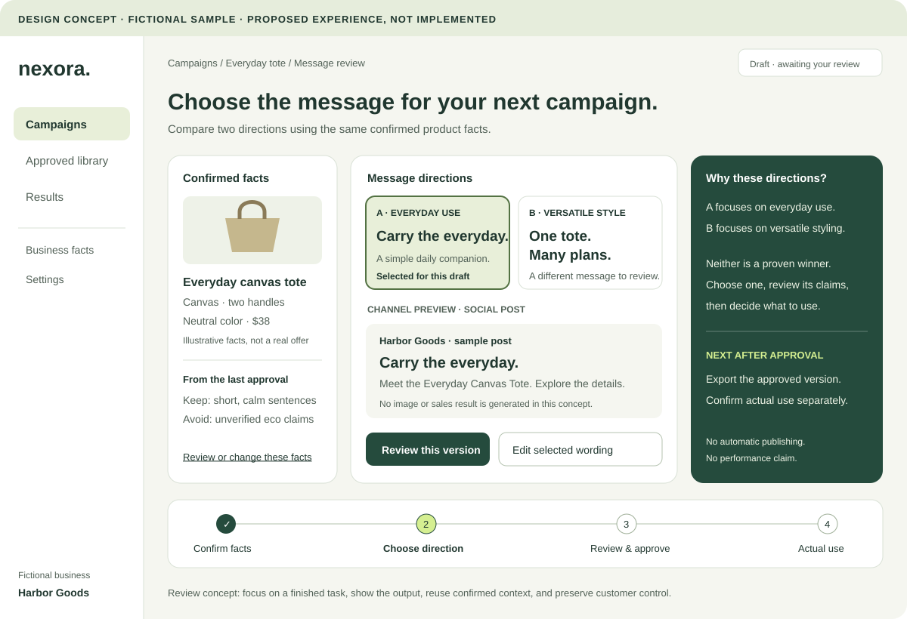
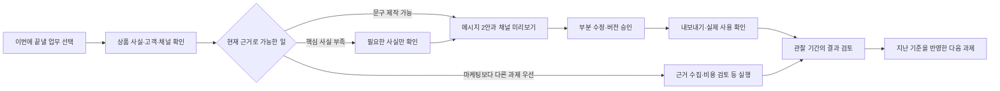

# NEXORA UI/UX·이탈 검토

검토일: 2026-11-10. 대상은 현재 작업 트리의 공개 화면, 가입, 첫 체크, 작업 공간, 제작·승인, 계획, 결과·성과, 가이드와 기록이다.

## 1. 전체 판단

현재의 녹색·밝은 바탕·라임 강조, 충분한 여백, 일관된 카드와 선택형 입력은 유지할 가치가 있다. 가입 전 체크, 선택 입력, 펼쳐 보는 근거, 허구 예시와 실제 자료의 분리도 잘 되어 있다. 화면 전부를 새로운 스타일로 바꾸는 것이 우선은 아니다.

가장 큰 마찰은 **시각적으로는 정돈되어 있지만, 고객이 얻는 결과가 추상적인 질문과 조사 과제로 보이는 것**이다. 유료 제품은 고객이 이미 하려던 일을 쉽게 끝내게 해야 한다. 현재는 계획·근거·결과를 기록하는 새 업무를 먼저 배우게 하는 부분이 크다.

이탈률은 현재 수집 자료로 계산할 수 없다. 다음 항목은 화면·코드에 근거한 개선 가설이며, 실제 이탈 원인으로 통계 검증한 결과가 아니다.

## 2. 화면 확인 범위

- 이번 세션의 실제 Chrome: 1440×1000 데스크톱, 390×844 모바일, 다크 모드·동작 줄이기 설정.
- 가입 전 방향→새로고침→가입→명시적 계정 저장→프로필·측정값→진단→계획→가이드 왕복→행동·결과→재로그인 흐름 확인.
- 0·미입력·분모 0 처리, 수동 출처, 저장 보존, 모바일 가로 넘침, 런타임 예외 검사 포함.
- 실제 AI 생성, 결제·이메일·게시·외부 지표 연결은 호출하지 않았다. 제작 화면은 소스와 제공자 미설정 상태를 확인했으며 실제 생성물의 영어·브랜드·이미지 품질은 평가하지 못했다.
- 샌드박스 파일 접근 오류를 해결한 최종 실행에서 위 검사 통과. 과거 호환 경로 `/diagnosis/result`는 기본 검사에서 제외한 뒤, 별도 검사에서 익명 계정의 `/workspace#assessment` 이동을 확인했다. 이 추가 검사는 인증된 계정의 모든 맥락을 검증한 것은 아니다.
- 키보드 전수 검사, 스크린리더, iPhone Safari, 저속 네트워크·운영 Core Web Vitals, 실제 미국 고객 사용성 평가는 별도 과제다. 접근성 인증 또는 전체 WCAG 충족을 주장하지 않는다.

이번 캡처는 [screenshots](screenshots/)에 보관했다. 데이터는 가상 QA 계정과 수기 검사 자료이며 실제 고객 성과가 아니다. 개발 모드 표시도 포함되어 있다.

| 화면 근거 | 주요 관찰 |
|---|---|
| [데스크톱 랜딩](screenshots/landing-desktop.png) | 큰 고민 문구와 선택 카드가 중심. 실제 업무 결과물은 첫 화면에 없음 |
| [모바일 랜딩](screenshots/landing-mobile.png) | CTA는 보이지만 설명과 큰 제목 뒤에 고민 선택이 이어짐. 완성물 미리보기까지 거리가 큼 |
| [첫 방향](screenshots/first-direction-desktop.png) | 업종별 질문·조사 과제를 제공. 고객 상품으로 만든 실행물은 아님 |
| [작업 기본 화면](screenshots/workspace-overview-desktop.png) | 다음 조사와 주간 계획은 명확. 반복 캠페인의 결과물·승인 대기는 중심에 없음 |
| [모바일 주간 계획](screenshots/weekly-plan-mobile.png) | 주간 이동 버튼·설명·진척 표시가 많은 세로 공간을 사용 |
| [성과](screenshots/performance-desktop.png) | 실제 기간·출처와 수치를 구분. 표·설명 밀도는 높음 |

## 3. 먼저 보존할 장점

1. 가입 전에 방향을 볼 수 있다. 가입 장벽을 무조건 처음으로 옮기지 않는다.
2. 모르는 자료를 0으로 만들지 않고, 가상 성공 점수를 제공하지 않는다.
3. 승인한 정확한 버전과 실제 사용을 구분한다. 다운로드만으로 실제 게시를 기록하지 않는다.
4. 가이드가 원래 계획·진단으로 돌아오는 맥락을 보존한다.
5. 기존 기록·통화·스냅샷을 함부로 바꾸지 않는다. 작업 공간 JSON 내보내기도 이미 있다.
6. 단계 이동 시 제목으로 초점을 옮기는 처리, 필드 라벨, 상태 안내, 모션 줄이기 대응의 기반이 있다.

이 장점은 신뢰·지원 비용·재방문에 도움이 될 가능성이 있다. 그러나 그 효과가 실측됐다는 뜻은 아니다.

## 4. 화면별 개선 사항

우선순위는 P0=유료 실험 전, P1=반복 사용 실험 전, P2=핵심 가치 확인 후다. 앱의 모든 기능을 같은 순서로 고치라는 의미는 아니다.

| ID·우선순위 | 확인된 상태·근거 | 권장 변경 | 검증할 행동 |
|---|---|---|---|
| U01·P0 랜딩 | `What’s holding your business back?`, `Find my next move`가 주된 약속. [LandingExperience](../../src/components/marketing/LandingExperience.tsx) | 첫 고객의 구체적 업무·받을 결과·다음 행동을 명시. 고객 상품의 채널 미리보기 1개를 함께 제공 | 첫 방문자가 설명 없이 고객·결과물·다음 버튼을 말할 수 있는가 |
| U02·P0 첫 가치 | 첫 결과가 업종별 질문과 자료 수집 과제. [첫 체크](../../src/components/check/FirstCheckExperience.tsx) | 자료가 충분하면 한 메시지 작업 또는 초안을 먼저 제공. 부족하면 필요한 최소 사실만 요청. 모든 사람에게 광고 제작을 강요하지 않음 | 첫 사용 가능한 결과의 승인까지 총시간·실제 사용률 |
| U03·P0 반복 입력 | 첫 체크의 상품 설명만으로는 제작 요건이 부족. 상세 프로필 보완 후 재진단 필요. [AssetsPanel](../../src/components/workspace/AssetsPanel.tsx) | 선택한 캠페인에서 필요한 상품·고객·채널을 인라인 보완. 저장될 사실과 적용할 새 버전을 확인한 뒤 이어감 | 중간 화면 이동·같은 정보 재입력 횟수 |
| U04·P0 필수 자료 과다 | 진단의 전체 누락 항목이 있으면 자료 수집 행동이 우선되기 쉬움. [assessment.ts:86](../../src/lib/business/assessment.ts#L86) | 선택한 업무에 필요한 자료를 구분. 메시지 초안과 인과 판단의 자료 요건을 다르게 설계 | 첫 실행을 무관한 자료 요구가 막는 비율 |
| U05·P0 제작 선택 | 기본값은 훅 3·광고문 2·대본 2·CTA 2. 고객이 4종 수량을 결정. [AssetsPanel](../../src/components/workspace/AssetsPanel.tsx) | ‘이 상품의 첫 소개’, ‘프로모션 교체’ 같은 과제를 고르면 필요한 묶음을 기본 제안. 수량 조정은 상세 설정으로 | 첫 생성 전 선택 수·시안 선택·승인 비율 |
| U06·P0 검토 화면 | 9개 텍스트 결과가 개별 편집·승인 대상으로 길게 나열될 수 있음 | 캠페인별 메시지 2안 비교→선택안의 채널 미리보기→부분 수정→정확한 묶음 승인으로 연결 | 수정 시간·사실 오류·실제 사용률 |
| U07·P0 기대 불일치 | ‘Draft studio’에서도 제공자 미설정이면 생성 불가. 사용자에게 서버 구성 설명 노출 | 고객에게 ‘현재 제작 이용 불가’와 가능한 다음 경로를 표시. 운영자에게만 상세 설정 원인 제공. 공개 모집 시 실제 가능한 범위를 약속 | 실패 뒤 복구·지원 요청·실제 서비스 가용성 |
| U08·P0 가격·신뢰 | `/pricing`은 유료 상품 안내가 아닌 Availability. 업체·약관·개인정보·회복 경로가 공개 구매 흐름에 충분히 없음 | 파일럿 범위·가격·포함 수정·AI/사람 역할·환불·지원·데이터 처리 안내. 준비 후 검증된 결제 경로 연결 | 가격 이해·구매 포기 이유·환불·지원량 |
| U09·P1 홈 | 큰 추상 제목과 조사 방향. [WorkspaceOverview](../../src/components/workspace/WorkspaceOverview.tsx) | 운영 중에는 ‘검토할 캠페인 1개’, ‘다음 일정’, ‘관찰 가능한 결과’가 첫 화면. 첫 방문과 재방문 레이아웃 분리 | 다시 온 사용자가 바로 하려던 작업을 끝내는가 |
| U10·P1 메뉴 | 내부 9개 섹션과 가이드, 별도 모바일 하단 메뉴 | 주요 이동을 캠페인·승인본·결과 정도로 묶고 설정·세부 기록은 상세 메뉴. 동일 과제의 계획·제작·성과를 연결 | 메뉴 왕복·뒤로 가기·작업 포기 |
| U11·P1 뒤로 가기 | 내부 이동에 `history.replaceState` 사용. [WorkspaceApp:83](../../src/components/workspace/WorkspaceApp.tsx#L83) | 의미 있는 섹션 이동은 브라우저 이력에 남기고, 뒤로 가기에서 선택 맥락 복원. 미저장 편집 보호도 함께 설계 | 브라우저 뒤로 가기로 직전 작업을 복원하는가 |
| U12·P1 이어하기 | 첫 체크 답은 저장하지만 진행 단계는 저장하지 않음. 저장 답이 있으면 재접속 시 단계 3으로 열림 | 답의 완성도와 현재 단계를 저장. 미완성 체크는 마지막 단계에서 재개하고 완성 결과는 결과로 이동 | 중간 단계 새로고침·뒤로 이동의 상태 복원 |
| U13·P1 저장 상태 | 전역 `Saved to your account`는 단순 `busy`의 반대 상태. 폼의 미저장 편집을 표현하지 못함 | ‘서버 저장본’과 ‘미저장 변경’을 구분. 저장 성공 시각·실패·재시도 표시 | 수정 후 이동·새로고침에서 데이터 손실과 오해 |
| U14·P1 주간 계획 | 모바일에서 큰 제목·설명·주간 이동 세 버튼이 계획보다 먼저 공간 사용 | 한 줄 주간 이동과 명확한 날짜 선택, 이번 주 실제 과제 카드 우선. 완료 진척은 보조 표시 | 계획 찾기·과제 시작까지 스크롤·탭 수 |
| U15·P1 결과 입력 | 별도 행동/사용 기록 뒤 지표 입력. 출처·기간 등 수기 부담. [ResultsPanel](../../src/components/workspace/ResultsPanel.tsx) | 승인본에서 ‘실제 사용했어요’로 연결하고 채널·버전·지표를 미리 선택. 출처·기간은 확인을 받아 저장. CSV 검토 가져오기를 먼저 시험 | 입력 완료율·정의 오류·주기별 지표 확보율 |
| U16·P1 성과 | 그래프·표가 정확하나 새 자료가 없으면 돌아올 새 이유가 적음 | 이번 기간의 새 관측, 비교 가능 여부, 아직 모르는 것, 다음 행동을 분리. 변화를 NEXORA 기여로 단정하지 않음 | 결과 검토 후 별도 다음 과제 사용 |
| U17·P1 가이드 | 공개 가이드는 8개이며 본문이 텍스트 중심 | 현재 과제의 예시 1개·짧은 체크리스트·바로 적용할 템플릿 제공. 교육을 필수 통과 단계로 만들지 않음 | 가이드 왕복 후 원래 작업 완료 |
| U18·P1 재방문·기억 | 승인본은 보관하지만 다음 생성의 자동 조건이 되지 않음 | ‘이번 작업에서 유지한 규칙/바뀐 사실’을 보여주고 사용자가 수정·제외 가능하게 함 | 두 번째 과제의 입력·수정 시간이 줄어드는가 |

U11~U13은 현재 구현에서 드러나는 구체적인 동작 위험이다. 전체 사용자 이탈을 설명하는 확정 원인은 아니다. 버전·승인·스냅샷 구조를 유지하면서 고쳐야 한다.

운영 목표인 `Everything depends on me`를 고른 경우 첫 숫자 입력이 매출·비용으로 연결되는 부분도 있다(`pairFor`). 운영 병목을 알아보려는 고객에게는 작업 시간·대기·오류 등의 자료가 더 적합하다. 새 측정 항목을 만들기 전에는 관찰 체크리스트로 시작하되 매출·비용이 운영 병목 자체를 측정한다고 표현하지 않는다.

## 5. 권장 화면과 흐름

아래는 새 제품 방향의 설계안이며 현재 구현·가용 기능을 나타내는 그림이 아니다.

[화면 설계 이미지 크게 보기](campaign-workspace-concept.svg). 확인한 사실, 두 메시지 방향, 채널 미리보기, 승인 이후 행동을 한 작업 안에 배치한 예시다. 이미지 속 상품·가격·문구는 전부 설명용 허구다.

### 랜딩

영문 제안: `Turn your next product campaign into work you can approve.`

짧은 설명에 대상 고객, 정확한 결과물, 사용 경로를 넣는다. 예를 들어 텍스트 상품이라면 ‘상품 사실을 확인하고 두 메시지 방향과 채널용 문구를 검토한다’고 설명한다. 완성 이미지·게시를 제공하지 않는데 광고 완성 전체를 약속하지 않는다.

첫 화면에는 실제와 구별된 예시 결과물을 배치한다. 왼쪽에 상품 사실 3개, 오른쪽에 메시지 A/B와 채널 미리보기, 아래에 ‘왜 이 두 방향인가’를 펼쳐 보게 한다. 선택하면 미리보기가 바뀌되 구매 성과 우위를 표시하지 않는다. 여기서 A/B는 시안 비교이며 무작위 실험의 결과가 아니다.

가입 전 제공 범위와 유료 제공 범위도 구별한다. 가격을 숨겨 클릭만 늘리는 실험은 하지 않는다. 실제 고객 사례가 생기기 전에는 가짜 후기·파트너 로고·매출 개선 수치를 넣지 않는다.

### 첫 작업

‘고민·업종·단계’만 묻는 대신 반복 업무를 선택하고, 그 업무에 필요한 사실을 결과 옆에서 확인한다. 현재 사업 체크는 탐색 경로로 유지할 수 있다. 분석 숫자가 없는 사용자의 문구 초안을 막을 필요는 없지만, 그 초안이 매출 부진 원인을 입증한다고 표시해서는 안 된다.

URL 가져오기는 추후 기능이다. 현재는 직접 설명·붙여넣기·승인된 자료를 받고, 어떤 사실을 쓸지 먼저 확인한다. 가져오기를 구현하면 추출 출처·수정 가능 요약·유효하지 않은 상품 주장 표시가 필요하다.

### 제작·승인

데스크톱은 왼쪽 ‘확인한 상품 사실과 제약’, 가운데 ‘채널 미리보기’, 오른쪽 ‘바꿀 점·이유·버전’의 구조를 제안한다. 모바일은 미리보기 먼저, 확인 사실·근거·이력은 접어서 제공한다.

처음부터 많은 결과를 생성하는 대신 메시지 방향 2개를 고른 뒤 선택안의 필요한 결과물을 만든다. 수정은 ‘더 짧게’, ‘할인 표현 제외’, ‘이 사실은 틀림’처럼 구체적인 요청으로 한다. 반영된 규칙은 고객이 확인한 뒤 다음 과제에 재사용한다. 승인 버튼은 어떤 버전·어떤 결과물 묶음에 적용되는지 명확해야 한다.

### 재방문 홈

첫 화면의 핵심은 다음과 같은 병렬 항목이다.

- **검토할 작업:** 다음 캠페인의 승인 대기본과 한 가지 결정.
- **곧 할 작업:** 고객이 정한 다음 상품·행사 일정과 필요한 자료.
- **확인할 결과:** 실제 새 관측만 표시하고 출처·기간·비교 가능 여부 제공.

월간 요약은 실제 사용한 결과물, 고객이 확인한 절감 시간, 포함·추가 비용, 다음 예정 과제를 보여준다. 시스템으로 측정한 편집 시간과 고객이 추정한 절감 시간을 구분한다. 접속 횟수 자체를 좋은 성과로 평가하지 않는다.

## 6. 더 쉽고 재미있게 만드는 시각적 요소

재미의 중심은 실제로 바뀐 자신의 작업을 보고 선택하는 경험이어야 한다.

| 제안 | 구체적인 상호작용 | 완료의 의미 |
|---|---|---|
| 메시지 방향 선택 | 상품 사실이 같은 2안의 구성·톤을 비교하고 선택 | 선택한 방향일 뿐 성과 우위가 아님 |
| 전후 비교 | 고객 원문과 수정본을 나란히, 바뀐 문장·이유 강조 | 편집 변화가 보임. 전환율 증가를 뜻하지 않음 |
| 실제 채널 미리보기 | 모바일 광고·이메일·상품 설명 문맥에서 보기 | 규격과 가독성 확인. 실제 게시 상태와 분리 |
| 짧은 진행 타임라인 | 사실 확인→초안→승인→실제 사용→관찰 | 실제 사건에만 체크 표시 |
| 승인본 라이브러리 | 상품·목표·채널·사용일로 찾고 다음 작업에 재사용 | 작업 자산이 쌓이고 반복 입력이 줄어듦 |
| 선택 후 반응 | 색·선택 상태와 짧은 전환으로 선택 결과 확인 | 서버 완료를 흉내 내는 대기 연출 금지 |
| 작고 구체적인 축하 | ‘첫 캠페인 승인본을 저장했습니다’ | 과제 진척만 축하. 사업 성공 점수로 변환하지 않음 |

상시 움직이는 장식, 로그인 스트릭, 가짜 수익 카운터, 근거 없는 사업 건강 점수는 구매 가치와의 연결이 약하다. 보상 요소를 넣더라도 실사용 가능한 산출물과 다음 작업 편의성을 우선한다.

## 7. 가독성·접근성의 구체적인 보완

색 토큰의 상대 휘도로 계산했을 때 `#69766c` 문자는 기본 배경 `#f6f7f2` 위에서 대비 약 **4.424:1**, `#eef1e9` 위에서는 약 **4.172:1**이다. 일반 크기 텍스트의 AA 기준 4.5:1에 못 미친다. 같은 문자색도 흰 배경에서는 약 4.763:1이라 결과가 다르다. 모든 화면의 회색이 실패한다는 뜻은 아니다. [W3C 대비 설명](https://www.w3.org/WAI/WCAG22/Understanding/contrast-minimum.html)

큰 제목의 `#759050`/`#f6f7f2` 대비는 약 3.328:1로 큰 글자 기준 3:1은 넘는다. 전체 강조색을 바꾸기보다 작은 본문·태그·플레이스홀더의 실제 색과 투명도를 먼저 조정한다. 9~12px 텍스트도 많으므로 핵심 설명·입력·오류는 모바일에서 읽기 쉬운 크기로 올린다. 작은 글자 크기 자체를 WCAG 위반이라고 단정하지 않는다.

주요 터치 조작에는 44×44px 정도의 충분한 영역을 권한다. AA 최소 기준은 예외·간격 조건을 포함한 24×24 CSS px이므로, 아이콘이 작다는 이유만으로 실패 판정을 내리지 않는다. 주간 계획을 여는 화살표 등 아이콘 전용 조작은 실제 클릭 영역과 인접 간격을 측정해야 한다. [W3C 타깃 크기 설명](https://www.w3.org/WAI/WCAG22/Understanding/target-size-minimum.html)

`globals.css`에는 reduced-motion에서 `html { scroll-behavior:auto }`를 선언한 뒤 같은 명시도의 전역 `scroll-behavior:smooth`가 다시 나온다. 별도 실제 브라우저 검사에서도 모션 줄이기 설정 상태의 계산 스타일이 `smooth`인 것을 확인했다. 마지막 선언 순서를 조정해야 한다. 앞선 검사가 다크 모드·화면 렌더링을 통과한 사실과 이 세부 설정의 정확성은 별개다.

중간 체크에서 업종만 선택하고 새로고침했을 때, 단계 선택을 마치지 않았는데 첫 방향으로 이동하는 동작(U12)도 별도 브라우저 검사에서 재현했다.

추가로 키보드 순서, 메뉴·단계 이동 후 초점, 승인 대화상자 복귀, 오류와 해당 필드의 연결, 확대 200%·400%, 긴 영어 상품명, 숫자 소수점·통화·시간대, 모바일 키보드와 하단 메뉴 겹침을 확인한다. 실제 표의 가로 스크롤은 전체 페이지 넘침과 구별한다.

## 8. 이탈을 줄였는지 측정하는 방법

현재 코드에서 제품 퍼널을 지속 수집하는 이벤트·청구 코호트 체계는 확인되지 않았다. 고객 사업 성과 기록과 NEXORA 자체 이용 분석은 별도 자료다.

| 사건 | 기록할 최소 맥락 | 구별할 것 |
|---|---|---|
| 첫 체크 시작·단계 완료·방향 열람 | 익명 세션, 화면·단계, 시간, 유입 경로 | 입력 자료 원문·사업 비밀을 분석 로그에 보내지 않음 |
| 작업 브리프 확인 | 계정·별도 과제 ID, 업무 유형 | 단순 페이지 열람과 구별 |
| 제작 요청·완료·실패 | 과제·요청 ID, 시간·오류 종류·원가 | 클릭 중복·재시도·복제 과제 구별 |
| 정확한 버전 승인 | 과제·결과물·버전, 승인 시각 | 생성·편집·다운로드와 구별 |
| 실제 사용 확인 | 버전, 채널, 사용일, 확인 출처 | 고객 자기보고와 실제 채널 로그 구별 |
| 두 번째 별도 과제 사용 | 계정, 새 과제 ID, 사용일 | 첫 과제 재생성은 반복 가치로 세지 않음 |
| 결제·갱신·해지·실패 복구 | 검증된 청구 사건·금액·환불·기간 | 브라우저 결제 성공 화면만 믿지 않음 |

첫 방향 도달률은 시작한 세션을 분모로, 7일 실제 사용률은 관찰 7일이 지난 대상만 분모로 쓴다. 첫 사용 후 30일 두 번째 과제 사용률, 첫 결제의 다음 결제·세 번째 결제를 따로 본다. 연간 선결제로 청구가 남아 있는 것과 실제 업무 사용이 계속되는 것은 다르다.

무료·유료, 셀프서비스·지원형, 고객군·유입 채널·가입 시기를 구분한다. 분모와 이탈 인원, 신뢰할 수 있는 관찰 기간을 함께 보여준다. 작은 초기 집단의 좋은 비율만으로 시장 적합성이나 통계적 개선을 선언하지 않는다.

월 이탈률 3%, 5%, 8%가 일정하면 원래 코호트의 12개월 잔존율은 각각 약 69.4%, 54.0%, 36.8%다. 새 고객으로 전체 수가 늘어도 기존 고객의 이탈은 가려질 수 있다. 이 값은 계산 예시이며 NEXORA의 현재 이탈률이 아니다.

## 9. 첫 사용성 검증과 개선 실험

처음에는 같은 고객 유형 5~8명에게 최근 실제 과제를 가져오게 하고 화면 공유로 관찰한다. 설명 없이 무엇을 얻을 것 같은지, 시작할 버튼이 무엇인지, 결과가 쓸 만한지, 다음 업무에서 다시 쓸 이유가 있는지 확인한다. 소규모 관찰은 문제 발견용이며 전환율 효과 추정용이 아니다.

| 실험 | 비교 | 1차 지표 | 함께 지킬 조건 |
|---|---|---|---|
| 업무 중심 첫 화면 | 현재 고민 문구 vs 구체적인 캠페인 결과 예고 | 적격 방문자의 첫 실제 사용 | 유료 전환·품질·환불이 악화되지 않는가 |
| 점진 입력 | 상세 보완 화면 왕복 vs 작업 안에서 최소 확인 | 승인까지 총시간·완료율 | 사실 오류·무단 자료 저장 증가 없음 |
| 메시지 비교 | 여러 개별 결과 나열 vs 두 방향 선택 후 묶음 | 승인 시간·실제 사용 | 생성 원가·수정 횟수 포함 |
| 브랜드 기억 | 기존 프로필만 vs 확인된 지난 수정 규칙 반영 | 두 번째 과제의 입력·수정 시간 | 오래되거나 틀린 규칙을 수정·제외 가능 |
| 재방문 홈 | 추상적인 다음 방향 vs 실제 승인 대기·다음 일정 | 업무 주기 내 두 번째 과제 사용 | 불필요한 알림·지원 시간 증가 없음 |

트래픽이 작으면 충분한 표본을 얻기 전까지 A/B 유의성을 주장하지 않는다. 먼저 관찰·인터뷰·동일 고객의 작업 비교로 큰 문제를 고친다. 각 실험의 관찰 창과 지표를 미리 정하고, 잘 나온 지표로 사후 교체하지 않는다.
