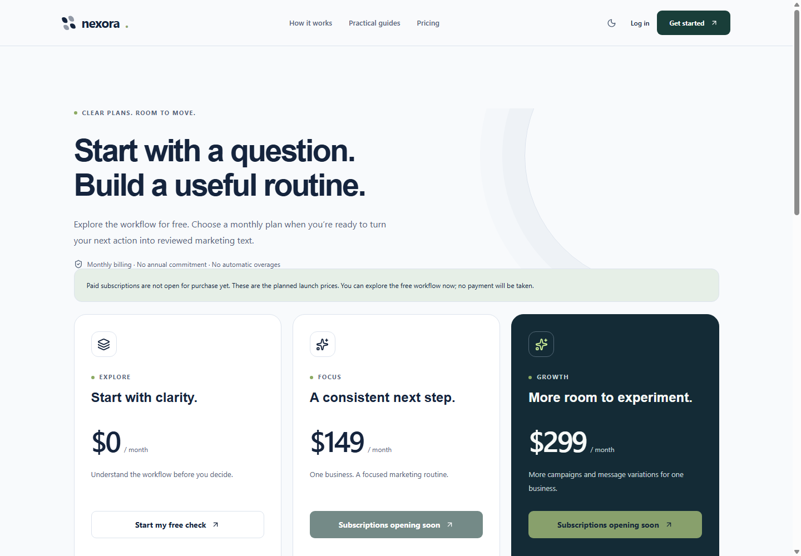

# 출시 준비 검증 기록

2026-11-10, 로컬 작업. **유료 운영 연결·배포 완료 증명은 아니다.** 총괄: [7일 출시 판단](../../../SEVEN_DAY_LAUNCH_PLAN.md).

## 통과한 검사

- `npm.cmd run test:run`: **14개 파일, 90개 테스트 통과**. 기존 소유자 분리·정확한 승인 버전·실제 측정치·주간 계획·참조 문구·명시적 체크 저장과 함께 구독 검사를 추가했다.
- 구독/계정 추가 검사는 무료 계정의 생성 차단, 서버 가격/금액/통화/세금별도/월 주기 검사, 유료 포함량과 실행 중 예약, 실패/이전 기간 제외, 계정 분리, 기간 말 해지/만료/미납, 운영에서 테스트 결제 차단, 결제 전 인증·맥락 확인, checkout idempotency, 중복 구독 방지, 잘못된 서명·본문 변조·만료·재전송, 웹훅 현재 상태 재조회·느린 이전 조회의 덮어쓰기 방지, 단일 사용 인증·복구 토큰, 새 비밀번호와 기존 세션 종료를 포함한다.
- TypeScript 검사 통과. **Next.js 16.4.6 프로덕션 빌드 통과**, 새 account/billing/legal 경로 포함.
- `npm.cmd audit --omit=dev --audit-level=high`: **운영 의존성 취약점 0건**. 전체 `npm.cmd audit --audit-level=high`도 통과했다. 개발 도구에는 minimatch와 연관된 **중간 위험 7개**가 남아 있으므로 전체 의존성 0건이라고 주장하지 않는다. 강제 메이저 변경은 하지 않았다.
- 기존 Next.js 16.3.6에서 감사가 보고한 치명적/고위험 항목을 확인하고 16.4.6으로, 대응 ESLint 설정과 안전한 범위의 나머지 의존성도 업데이트했다. Stripe는 공식 SDK 23.1.0을 사용한다. 감사는 실행 시점의 알려진 취약점 확인이며 모든 보안 문제의 부재를 인증하지 않는다.

## 실제 Chrome 검사

격리 SQLite `.qa/launch/browser.sqlite`, 격리 Chrome 프로필, localhost 3100에서 진행했다. 외부 AI·결제·메일 키는 비워 두었고 신규 구매는 닫았다. 운영 데이터는 사용하지 않았다.

프로덕션 빌드에서 메인 → 가이드 → 가격 → 예시 → 익명 체크 → 가입 → 명시적 저장 → 프로필·측정치 → 진단 → 주간 계획 → 수동 실행·결과 → 재시작/재로그인의 고객 과정을 확인했다. 기존 경로 이동, 0과 미입력 값, 기록 보존, 모바일·다크 모드·동작 줄이기도 확인했다.

추가로 가격 $149/$299·포함량, 구매 비활성, 가격 320/390/768/1024/1440px 가로 넘침 없음, 무료 계정의 Plan & billing, 결제 상태 확인, 미설정 메일의 실제 오류 안내, 복구 잘못된 링크, 미확정 법적 판매자 초안 표시를 검사했다. 실행 마지막에 브라우저 런타임 예외가 없었다. 마지막 모바일 정리는 미저장 체크가 결제 관리 화면 상단을 가리지 않도록 한 것으로, 새 빌드에서 화면과 결제 상태 확인을 다시 검증했다.

개발 서버에서 `/diagnosis/result`를 처음 컴파일할 때 한 차례 브라우저 탐색이 시간 초과됐다. 프로덕션 빌드에서는 해당 리디렉션을 포함한 전체 과정이 통과했다. 무료 계정이 Stripe 키 없이 결제 상태를 확인할 때 발생한 오류는 브라우저 검사로 발견해 수정했고 회귀 테스트도 추가했다. 이 두 실패를 통과 결과로 바꾸어 기록하지 않았다.

## 사업 계산 도구

Python 재계산으로 JSON/CSV를 생성했다. 같은 가정을 가진 오프라인 HTML을 실제 Chrome에서 열어 다음을 대조했다.

- 기본 고객 354명 → 대표 월 수령 추정 **30,072,136원**.
- 고객 272명 → **22,036,486원**.
- 기본 포함량 사용률을 40%에서 100%로 바꾸면 목표 고객 **406명**.
- 잘못된 수치 입력 안내, 모바일 가로 넘침 없음.

두 구현의 결과가 맞는다는 것은 모형의 일관성 검사이며 세무 신고액이나 실제 비용을 확정하는 검증은 아니다.

## 실제 화면

[모바일 가격](screenshots/pricing-mobile.png) · [모바일 결제 관리](screenshots/billing-mobile.png) · [계정 복구](screenshots/recovery-mobile.png) · [원가·세금 계산 도구](screenshots/unit-economics-desktop.png).

## 통과했다고 볼 수 없는 항목

- 운영 필수값 검사 `npm.cmd run launch:preflight`는 현재 **19개 설정 조건에서 차단**된다. 같은 미설정이 여러 조건에 걸릴 수 있으므로 독립된 19개 기능 미구현이라는 뜻은 아니다. 실제 AI/Stripe/Resend 계정, 공개 HTTPS, 영구 DB, 판매자/지원 정보, 정책 검토 및 실제 통과 기록을 요구한다.
- 실제 AI 호출/원가/영문 품질, Stripe 네트워크 결제/갱신/환불/입금, 실제 이메일 전달을 이번 검사에서 수행하지 않았다. SDK와 네트워크 요청은 자동 테스트에서 fixture로 대체했다.
- 운영 호스팅·모니터링·백업 복원·실제 iOS Safari·스크린리더·고객 업무 가치·차월 갱신/이탈은 별도 확인해야 한다.
- 로컬 서버와 검증 브라우저는 종료했다. 운영 배포·외부 계정 생성·광고·게시·고객 연락·실결제는 수행하지 않았다.
